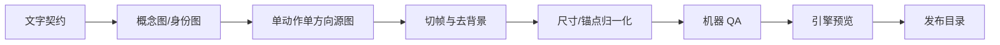

# AI 美术生产管线

AI 生图适合快速建立方向和批量变体，但“生成成功”不等于“可进游戏”。正式资源必须经过身份锁定、动作拆分、去底、归一化、机器 QA 和引擎预览。

## 一、先写资源契约

开始生图前记录：

- 用途：地图地表、建筑、角色、怪物、技能 VFX、图标或 UI 框。
- 视角：正交、俯视、3/4 俯视、侧视。
- 光向与材质：例如左上柔光、手绘高对比边缘。
- 画布、最终尺寸和缩放策略。
- 是否需要透明通道、脚底锚点或无阴影版本。
- 动作、方向、帧数和循环方式。
- 禁止项：文字、水印、额外角色、裁切主体、纯色残留、错误武器等。

契约先于 prompt。否则不同批次会在比例、方向和风格上持续漂移。可从[美术资产清单模板](../templates/art-asset-manifest.template.json)开始记录来源、处理和验收证据。

## 二、生成阶段分工



### 概念图

只锁定身份、轮廓、配色和装备。概念图不应被直接硬切成动作帧。

### 动作源图

动态角色推荐“一次生成一个动作和一个方向的小条带”。先做右向，确认身份和动作，再生成上/下；左向在不影响武器手持和服装不对称时由右向镜像。

### 场景资产

场景生成应按模块而不是整张地图：

- 大型轮廓：山体、树群、建筑主体。
- 中型地标：桥、矿架、门楼、摊位。
- 小型装饰：草、石、木箱、旗帜。
- 地面贴花：道路边、泥痕、浅水和裂纹。

整图预渲染适合概念封面，不适合承担碰撞、交互和动态玩法。

## 三、Prompt 结构

推荐顺序：

1. **身份锁定**：所有帧都是同一个角色/怪物/建筑。
2. **用途与视角**：game sprite、3/4 top-down、orthographic 等。
3. **主体细节**：轮廓、服装、武器、材质、战力等级。
4. **动作与节奏**：接触、经过、离地、回收等关键姿势。
5. **构图约束**：完整主体、固定脚点、统一缩放、留透明边距。
6. **风格与光向**：与项目美术基线一致。
7. **禁止清单**：no text、no extra limbs、no cropped feet、no watermark 等。

不要只写风格词。动作、方向、锚点和禁止项对游戏可用性影响更大。

## 四、透明背景与去底

透明资源优先流程：

1. 若模型能可靠输出 alpha，直接生成透明背景。
2. 否则使用与主体颜色冲突的纯色键背景。
3. 本地去底后清理色边、孔洞和断裂小块。
4. 检查四角 alpha、主体连通区域和半透明边缘。

绿色键背景并不天然安全。紫色技能特效中若含绿色毒雾，色键会误删；应按资源配色选择键色或使用遮罩。

## 五、归一化

每帧必须独立完成：

- 裁出可见主体边界。
- 按目标高度或脚点比例缩放，而不是简单拉伸到画布。
- 放回固定画布，统一脚底基线。
- 保留动作所需的刀光、尾巴和法杖边距。
- 导出 RGBA，禁止意外调色板模式或不透明黑底。

地面单位以脚底为锚；飞行单位需要单独的悬浮中心和影子锚点。

## 六、版本与发布目录

推荐：

```text
art/<category>/<asset_id>/
├── source/          原始生成图和生成参数
├── work/            去底、切帧和中间结果
├── qa/              报告与预览
└── published/v2/    游戏实际引用的版本
```

- 不直接覆盖已经发布的资源；新结果进入新版本目录。
- 清单记录资源 ID、版本、来源、处理脚本版本和哈希。
- 运行时只引用 `published/`，不扫描 `source/`。
- 失败资源保留在工作区或归档，不进入游戏导出包。

## 七、机器 QA

不同资源至少检查：

| 资源 | 自动检查 |
|---|---|
| 角色/怪物 | 帧数、尺寸、RGBA、透明角、脚点波动、主体覆盖、帧差异 |
| 建筑/道具 | 主体连通块、透明边缘、脚座宽度、画布占用 |
| 技能 VFX | 透明角、亮度范围、主体覆盖、不同特效哈希不重复 |
| 地形块 | 接缝、边缘颜色差、尺寸、碰撞/视觉标记 |
| UI 图标 | 安全边距、尺寸、alpha、缩小时辨识度 |

机器 QA 不能判断“是否威猛”“动作是否有力量感”，因此还需要联系人眼验收。

## 八、人工验收

- 在真实地图背景上看，不只在透明棋盘上看。
- 按游戏实际显示尺寸看，不只放大看原图。
- 播放完整循环，检查脚点跳动、方向和动作读感。
- 同屏放入同等级和不同等级单位，检查战力层级是否一眼可辨。
- 在目标手机上检查细节是否糊成色块、透明叠层是否过重。
- 对比项目已有资产，拒绝单张好看但风格不一致的结果。

## 九、版权与可追溯性

- 参考图只用于构图、色彩或节奏分析，不直接复制可识别角色和商标。
- 记录生成模型、日期、提示词版本和后处理步骤。
- 不提交无法确认授权范围的音频、字体和素材包。
- 对外发布前由项目负责人确认模型和素材许可满足发行平台要求。

## 十、常见失败

| 失败 | 原因 | 改进 |
|---|---|---|
| 多方向像不同角色 | 一次大表格生成，身份漂移 | 单动作单方向，概念图锁定身份 |
| 黑底或绿边 | 去底未验收 | alpha/边缘自动检查加人工放大检查 |
| 人物移动时上下跳 | 每帧独立裁切后未归一脚点 | 固定画布和脚底基线 |
| 怪物只有面朝屏幕 | 缺方向契约，运行时复用单图 | 四方向资源或明确镜像规则 |
| Boss 像普通怪放大 | 只有 scale 区分等级 | 独立轮廓、装备和动作节奏 |
| 特效遮住整个战场 | 只按原图尺寸接入 | 在真实摄像机缩放下校准覆盖范围 |

## 十一、完成标准

最低可用：尺寸、透明通道、命名和运行时加载正确。

正式发布：资源通过专题自动检查、目标设备预览和项目风格评审；源图、处理流程、版本与发布文件可追溯，并完成[美术资产发布检查表](../checklists/art-release.md)。
