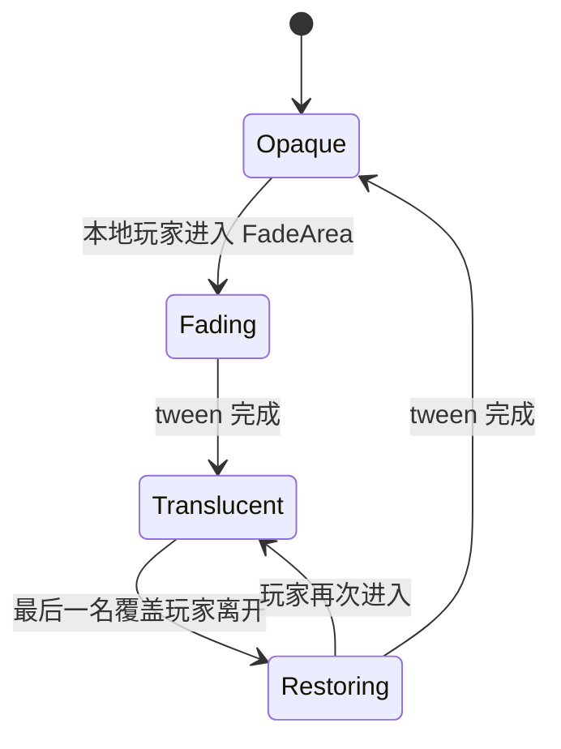

# 交互建筑与半透明遮挡

俯视角和 3/4 视角游戏中，高建筑经常遮住角色。正确做法不是把整栋建筑永久调淡，而是把视觉、碰撞、交互和遮挡检测拆开，在玩家真正进入遮挡区时只淡化视觉层。

## 一、四个独立边界

| 边界 | 作用 | 通常大小 |
|---|---|---|
| `visual_bounds` | 图片显示范围 | 最大，包含屋顶和招牌 |
| `footprint` | 实体碰撞脚座 | 只覆盖落地部分 |
| `interaction_area` | 可点击/按键交互范围 | 比脚座略大，适合触控 |
| `fade_area` | 角色被建筑前景遮挡的范围 | 覆盖屋顶/墙面投影，不等于整张图片 |

共用一张矩形碰撞体往往会同时造成“离得很远就能交互”和“走到门口却被挡住”。

配置见[建筑遮挡模板](../templates/building-occlusion.template.json)。

## 二、推荐节点结构

```text
InteractiveBuilding (Node2D, foot anchor)
├── VisualRoot
│   ├── BaseVisual          不透明脚座/地面部分
│   └── OccludingVisual     屋顶、树冠、上层墙面，可淡化
├── SolidBody
│   └── FootprintShape
├── InteractionArea
│   └── InteractionShape
└── FadeArea
    └── FadeShape
```

如果资源无法拆成上下两张图，也可以淡化整张 `VisualRoot`，但碰撞和交互节点仍不能跟着淡化或禁用。

## 三、状态规则



推荐默认值：

- 半透明 alpha：`0.40–0.55`，仍能看清建筑身份。
- 过渡时间：`0.12–0.20s`，避免闪烁和明显延迟。
- 仅检测玩家碰撞层，不检测怪物、投射物和掉落物。
- 多人或多角色情况下维护覆盖计数，不使用简单布尔值。

## 四、参考实现

下面是 Godot 4 风格伪代码。核心思想同样适用于 Unity Trigger、Unreal Overlap 或自研引擎。

```gdscript
var covered_actor_ids: Dictionary = {}
var fade_tween: Tween

func on_fade_body_entered(body: Node2D) -> void:
    if not body.is_in_group("local_view_actors"):
        return
    covered_actor_ids[body.get_instance_id()] = true
    set_occluded(true)

func on_fade_body_exited(body: Node2D) -> void:
    covered_actor_ids.erase(body.get_instance_id())
    if covered_actor_ids.is_empty():
        set_occluded(false)

func set_occluded(value: bool) -> void:
    var target := 0.45 if value else 1.0
    if fade_tween and fade_tween.is_valid():
        fade_tween.kill()
    fade_tween = create_tween()
    fade_tween.tween_property(occluding_visual, "modulate:a", target, 0.14)
```

### 为什么使用对象集合

简单计数能处理多数情况，但对象集合更容易处理角色断线、销毁或重复进入事件。定期清理失效对象，避免建筑永久保持半透明。

## 五、脚底锚点与 Y 排序

- 建筑节点原点放在门槛或建筑脚座中心。
- 视觉图片相对脚点向上偏移。
- 碰撞脚座围绕原点布置。
- 玩家位于脚点后方时建筑可自然盖住玩家；位于前方时玩家画在建筑前。
- 屋顶等始终位于角色前方的部分放入独立前景层，并由遮挡逻辑淡化。

不要用图片中心参与 Y 排序。建筑图片越高，中心点误差越明显。

## 六、交互规则

建筑淡化只解决可见性，不应改变交互：

- 交互候选由距离、视线或交互区域决定。
- PC 可以使用鼠标/按键；手机使用独立的大触控按钮。
- UI 只在发起交互的本地玩家打开。
- 联机时客户端发送“请求交互”，主机验证距离和建筑状态后返回结果。
- 其他玩家可以看到世界状态变化，但不应被迫打开同一个商店或打造界面。

## 七、常见失败

| 现象 | 根因 | 修复 |
|---|---|---|
| 一名玩家离开后建筑立刻变实 | 用布尔值，没考虑其他覆盖玩家 | 使用对象集合或引用计数 |
| 淡化后不能交互 | 把整个建筑节点禁用或隐藏 | 只调整视觉 alpha |
| 手机手形按钮无反应 | 触控只更新候选，没有立即派发 | 在触控释放/点击时发送交互命令 |
| 所有人同时打开商店 | UI 打开事件被当成世界广播 | 世界状态同步，面板本地打开 |
| 建筑缩得很小才能不挡路 | 图片、脚座、交互体绑定为同一尺寸 | 拆分四个边界 |
| 角色仍被屋顶完全遮住 | FadeArea 与实际屋顶投影不一致 | 在预览中显示遮挡区域并调校 |

## 八、验收标准

最低可用：角色进入遮挡区后视觉变淡，离开后恢复，碰撞和交互始终有效。

正式发布：

- 多名角色重叠时不会提前恢复。
- 快速进出不会产生 tween 抢占或闪烁。
- 建筑脚点排序正确，角色下半身始终可读。
- PC、手机和联机远程玩家均能独立交互。
- 通过[建筑交互检查表](../checklists/building-interaction.md)。
