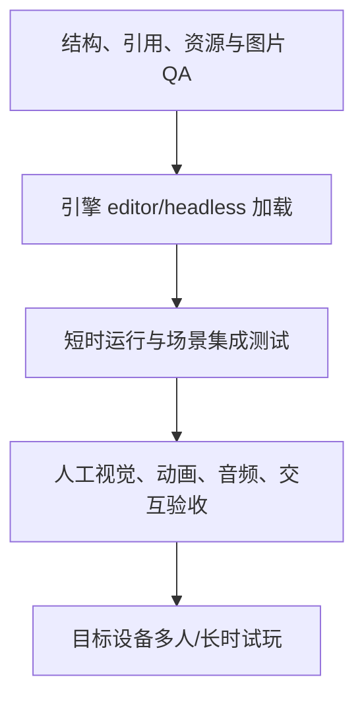

# 质量门禁

游戏内容生产不能只靠“打开看了一眼”。推荐建立从便宜到昂贵的分层门禁，让格式和引用错误尽早失败，把人工时间留给构图、动作、音色和手感。

## 一、门禁金字塔



越靠下运行越快、覆盖越广；越靠上越接近真实体验、成本越高。任何一层都不能完全替代其他层。

本仓库使用 GitHub Actions 自动运行结构、链接和模板交叉契约校验。引擎无界面检查仍由采用项目在安装对应引擎的 CI 或发布机上执行。

## 二、结构门禁

适用于 JSON、YAML、CSV 和资源清单：

- 文件可解析，`schema_version` 受支持。
- ID 唯一，引用存在，没有循环依赖或非法空值。
- 路径为项目相对路径且资源存在。
- 规格中的数量、范围和枚举合法。
- 生成物记录源规格摘要，能检测陈旧构建。

## 三、图片与动画门禁

- 文件格式、尺寸、色彩模式和 alpha 正确。
- 透明资源角落不残留黑/绿底。
- 主体覆盖率和主要连通块合理。
- 动画帧数完整，脚底基线与比例稳定。
- 相邻帧不是完全重复。
- 图标有安全边距，在实际显示尺寸仍可辨。
- 资源哈希检查可以防止多个名称误用同一占位图。

图片指标应输出 JSON 报告和拼图/动图预览，方便机器与人共同审阅。

## 四、引擎无界面门禁

推荐至少运行两种模式：

1. 编辑器无界面导入并退出：发现脚本解析、资源导入和场景依赖错误。
2. 指定测试场景短时运行：发现初始化、Autoload、信号连接和运行时加载错误。

Godot 示例：

```powershell
godot --headless --path game --editor --quit
godot --headless --path game tests/runtime_smoke.tscn
```

命令和退出策略按项目调整，但必须有超时，避免 CI 因场景不退出永久挂起。

## 五、专题集成门禁

### 地图

- 关键路线连通、出生点安全、运行包可加载。
- 视觉层级不会盖住角色。
- 峰值刷怪不阻塞输入和 UI。

### 建筑

- 遮挡进入/退出、多人覆盖、交互和面板本地性。

### 技能

- 冷却、资源、目标和数值只结算一次。
- 表现缺失安全回退。
- 远程客户端只重放表现。

### UI

- 目标分辨率和安全区布局快照。
- 触控区域、输入隔离和关键完整流程。

### 动画

- 状态优先级、方向切换、命中帧和死亡结束状态。

## 六、人工视觉验收

自动测试通过后，按固定场景和观察问题评审：

- 地图：路线是否可读，区域是否有身份，前景是否遮挡关键战斗。
- 建筑：大小是否匹配角色，脚座是否落地，淡化后是否仍能认出建筑。
- 技能：方向、范围和命中是否一致，不同职业是否易区分。
- 精灵：四方向是否真的转身，动作是否有力度，脚点是否稳定。
- UI：信息层级、对齐、字号、按钮可点击性和死亡/断线等异常状态。
- 音频：重复度、响度、限流、环境音与战斗音层次。

评审结果应记录截图、设备、版本和稳定对象 ID，不只写“感觉不对”。

## 七、性能门禁

至少记录：

- 峰值同屏单位和粒子数。
- CPU 帧时间、GPU 帧时间、内存和纹理占用。
- 地图块加载峰值和网络状态快照大小。
- 高频普攻/溅射下音频声道数。
- 手机持续运行后的温度、降频和断线情况。

性能测试必须使用接近正式资源和正式数量的场景；占位图通过不代表正式大图也通过。

## 八、联机门禁

至少用两台真实设备覆盖：

- PC 主机 + 手机远程玩家。
- 远程技能学习、装备、拾取、宝箱、建筑、商店和 Boss 入口。
- 等级、基地生命、背包、技能槽和队友面板同步。
- 网络短暂抖动后的状态一致性和提示。
- 面板只在发起者本地打开。
- 地图版本只校验当前联机地图及其依赖。

主机迁移和重连成本较高时可以明确标记为非目标，但断线检测和用户提示仍应存在。

## 九、基线失败管理

大型项目可能已有与本次修改无关的失败。正确处理方式：

1. 运行修改前基线并保存失败列表。
2. 运行目标测试，要求全部通过。
3. 运行扩大回归，对比失败集合。
4. 只有确认没有新增失败，才能说明“既有基线失败与本次无关”。

不要用“本来就有失败”跳过比较，也不要为了让测试全绿而修改无关文件。

## 十、发布证据

每次发布建议保存：

```text
build/qa/<version>/
├── structural-report.json
├── asset-report.json
├── engine-headless.log
├── runtime-smoke.log
├── screenshots/
├── device-matrix.md
└── known-issues.md
```

完成标准不是“代码提交了”，而是能指出哪组自动结果和哪次目标设备验收证明功能可用。
