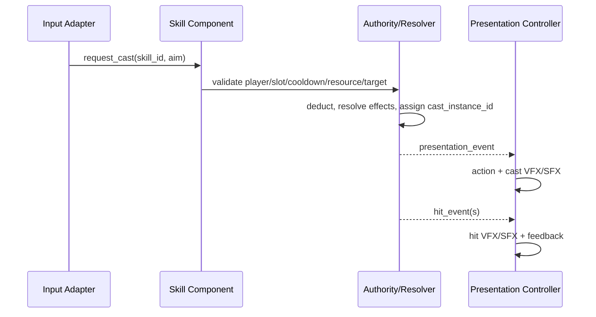

# 可配置技能表现系统

一个可复用技能系统应把“技能做了什么”和“技能看起来、听起来怎样”分开。否则每新增一个职业，角色控制器就会增加技能 ID 分支，联机时还容易重复扣蓝、重复伤害或漏播特效。

## 一、五层职责

| 层 | 负责 | 不负责 |
|---|---|---|
| Skill Definition | 冷却、消耗、等级、目标规则 | 加载具体图片和音频 |
| Effect Resolver | 伤害、治疗、控制、位移、吸血、减甲、溅射 | 播放表现 |
| Skill Component | 学习、槽位、冷却、资源验证、施法请求 | 按技能 ID 硬编码特效 |
| Presentation Controller | 动作、施法 VFX、命中 VFX、SFX、镜头反馈 | 修改生命、蓝量和状态 |
| Input Adapter | 键盘、鼠标、触控瞄准和取消 | 决定最终伤害是否合法 |

技能数值模板见[技能定义模板](../templates/skill-definition.template.json)，表现模板见[技能表现模板](../templates/skill-presentation.template.json)。

## 二、标准化数据流



单机中这些组件可以在同一进程，职责仍应保持。联机中主机/服务器是唯一权威；远程客户端只消费表现事件。

## 三、技能定义

一个通用技能定义至少包含：

- 稳定 `skill_id`、名称键和类型。
- 主动/被动/大招分类。
- 学习等级和最大技能等级。
- 冷却、资源消耗和每级数值。
- 目标形状：自身、单体、圆形、扇形、矩形、直线或点选区域。
- 作用范围、角度、最大目标数和阵营过滤。
- 一个或多个效果：伤害、治疗、状态、位移、召唤等。
- `presentation_id`，而不是直接塞入资源路径。

### 被动技能

被动仍然是技能数据，但不进入主动释放流程：

- UI 中显示图标、等级和“被动”标记。
- 按钮不可点击，不呈现冷却遮罩。
- 效果由属性聚合器、战斗钩子或状态系统持续应用。
- 联机时主机计算，客户端显示结果与 buff 图标。

## 四、表现定义

表现配置建议独立包含：

- `icon_asset_id`：选择界面和 HUD 使用的统一语义图标资源 ID。
- `action`：通用动作，如 `attack`、`cast`、`channel`。
- `cast.vfx_id`、`travel.vfx_id`、`hit.vfx_id`。
- `cast.sfx_id`、`travel.sfx_id`、`hit.sfx_id`。
- VFX 尺寸、持续时间、层级、旋转与跟随规则。
- 屏幕震动、命中停顿、飘字样式等可选反馈。

同一个技能定义可以绑定不同皮肤的表现配置；同一表现资源也可以被多个数值版本复用。

## 五、表现事件契约

事件应包含足够信息，让客户端不重新推导玩法：

```text
event_id, event_seq, cast_instance_id, caster_id, skill_id, presentation_id,
phase, origin, facing, target_position, target_ids,
seed, timestamp, optional_intensity
```

- `cast_instance_id` 在一次施法的 cast、travel 和多个 hit 事件之间保持一致。
- 每个具体表现事件拥有不同的 `event_id`，客户端按它去重；推荐使用会话 ID + 单调序号组合。
- `event_seq` 是发送端会话内单调递增的诊断/排序序号。可靠有序通道可以用它检测缺口；乱序通道不能仅因序号较小就丢弃尚未处理的合法 `event_id`。
- `seed` 让随机音效、碎片方向等表现保持一致。
- `phase` 区分 cast、travel、hit、expire。
- 客户端不能根据 `target_ids` 再次造成伤害。

## 六、角色动作可以通用

多数技能不需要专属全身动画。角色动作契约只需表达意图：

- `attack_light`：快速近战或射击。
- `attack_heavy`：大幅度挥击。
- `cast_quick`：短施法。
- `cast_channel`：持续引导。
- `defend`、`hit`、`death`。

每个角色动画清单必须提供动作能力表或别名，例如把 `attack_light`、`attack_heavy` 映射到基础 `attack`。表现控制器先解析别名，再回退到该角色确实拥有的动作。技能个性主要由刀光形状、颜色、节奏、命中反馈和音色建立。只有位移、处决、变身等明显改变身体轨迹的技能才需要专属动作。

## 七、职业视觉语言

为每个职业写一份简短视觉语法，避免所有技能都像法师圆形法阵：

| 类型 | 轮廓 | 节奏 | 命中反馈 |
|---|---|---|---|
| 近战战士 | 宽、厚、低重心 | 起手稍慢，命中重 | 冲击、尘土、金属 |
| 刺客 | 窄、锐、沿攻击方向 | 快速出现和收束 | 紫黑刀痕、少量暗红碎片 |
| 法师 | 圆、层叠、元素轨迹 | 蓄力、飞行、爆发 | 元素爆炸和余波 |
| 弓箭手 | 细线、锥形、分裂轨迹 | 发射清晰，命中短促 | 箭矢、穿刺、分裂 |

溅射、分裂箭和范围法术应有不同视觉认知：近战溅射是以攻击者为原点、朝前的扇形；分裂箭是多条独立弹道；范围法术通常围绕目标点展开。

## 八、VFX 的时间结构

一个清楚的技能通常包含：

1. **预备**：短暂轮廓或动作，告诉玩家技能开始。
2. **释放**：主图形沿目标方向出现。
3. **命中**：目标处更短、更亮的反馈。
4. **余韵**：低亮度残影或粒子快速消失。

大招不只是把普通特效放大。应同时提升轮廓宽度、亮度层级、持续节奏、命中反馈和声音层次，同时保持战场中心可读。

## 九、音效规则

- 施法和命中使用不同事件，避免“挥空也像命中”。
- 高频普攻和溅射设置限流，例如同类重叠声每 `80–150ms` 最多一次。
- 使用少量音高/音量变体降低机械重复。
- 大招分为预备、爆发和尾音，不靠单个高音量文件。
- 音效缺失时允许静默或通用回退，不阻止技能结算。

## 十、移动端瞄准

推荐 MOBA 式触控流程：

1. 按下技能按钮，显示对应形状和最大范围。
2. 手指移动，更新目标方向或目标点。
3. 手指进入技能按钮右上方取消区，预览变为取消状态。
4. 松开时若在取消区则取消，否则提交施法请求。
5. 输入层只提交请求；最终范围、冷却和资源由权威端验证。

触控命中区域应大于可见图标，瞄准期间临时屏蔽同一触点触发移动摇杆或世界交互。

## 十一、容错和兼容

- 未配置动作时根据技能类型选择通用动作。
- 缺少 VFX/SFX 时使用职业或全局回退资源。
- 对同一缺失资源只警告一次，避免刷屏和卡顿。
- 无效表现 ID 不得阻止数值结算。
- 旧技能可继续读取原字段，由适配层逐步迁移。
- 被动或未解锁技能不能因为缺少主动按钮而从 UI 完全消失。

## 十二、常见失败

| 现象 | 根因 | 修复 |
|---|---|---|
| 技能学会后仍是灰色 | 槽位状态、本地状态和权威状态不同步 | 使用稳定技能 ID，权威确认后统一重绑槽位 |
| 远程玩家无法施法 | 客户端直接调用本地伤害函数 | 请求发往权威端，结果和表现再广播 |
| 远程客户端双倍伤害 | 客户端收到特效后又执行效果 | Presentation Controller 只播放表现 |
| 所有职业特效相似 | 运行时只有通用圆形粒子 | 建立职业视觉语法和表现配置 |
| 攻速高时声音糊成一片 | 每次溅射目标都播放声音 | 每次攻击只发一个溅射事件并限流 |
| 图标、名字或效果对不上 | 多处重复维护映射 | 技能 ID 关联单一表现 ID |

## 十三、验收标准

最低可用：技能数值与表现分文件配置，缺资源不影响结算，主动和被动 UI 语义正确。

正式发布：

- 单机、主机和远程客户端看到相同表现但只结算一次。
- PC 键鼠和手机拖拽瞄准都能释放与取消。
- 同职业技能有统一语言，不同职业易于区分。
- 高频攻击、范围命中和大招音效层次清楚且不过载。
- 通过[技能发布检查表](../checklists/skill-release.md)。
