# 幻想 RPG 图标与战斗特效 v1资源目录

> 本文档由 `python tools/build_resource_pack.py` 自动生成，请勿手工修改。

当前包含 **95 个资源条目**。

## 饰品图标

| 预览 | 资源 ID | 描述 | 规格 |
|---|---|---|---|
|  | `item_amulet_fire` | 可跨项目复用的饰品图标。 | 64×64 RGBA · single |
|  | `item_amulet_steel` | 可跨项目复用的饰品图标。 | 64×64 RGBA · single |
|  | `item_amulet_titan` | 可跨项目复用的饰品图标。 | 128×128 RGBA · single |
|  | `item_war_ring` | 可跨项目复用的饰品图标。 | 128×128 RGBA · single |
|  | `item_ring_defense` | 可跨项目复用的饰品图标。 | 64×64 RGBA · single |
|  | `item_ring_fire` | 可跨项目复用的饰品图标。 | 64×64 RGBA · single |
|  | `item_ring_power` | 可跨项目复用的饰品图标。 | 64×64 RGBA · single |
|  | `item_ring_steel` | 可跨项目复用的饰品图标。 | 64×64 RGBA · single |

## 防具图标

| 预览 | 资源 ID | 描述 | 规格 |
|---|---|---|---|
|  | `item_armor_fire` | 可跨项目复用的防具图标。 | 64×64 RGBA · single |
| 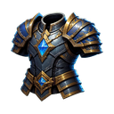 | `item_armor_guardian` | 可跨项目复用的防具图标。 | 128×128 RGBA · single |
|  | `item_armor_leather` | 可跨项目复用的防具图标。 | 64×64 RGBA · single |
|  | `item_armor_plate` | 可跨项目复用的防具图标。 | 64×64 RGBA · single |
|  | `item_boots_fire` | 可跨项目复用的防具图标。 | 64×64 RGBA · single |
|  | `item_boots_leather` | 可跨项目复用的防具图标。 | 64×64 RGBA · single |
|  | `item_boots_steel` | 可跨项目复用的防具图标。 | 64×64 RGBA · single |
| 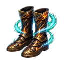 | `item_boots_windfire` | 可跨项目复用的防具图标。 | 128×128 RGBA · single |
|  | `item_helm_fire` | 可跨项目复用的防具图标。 | 64×64 RGBA · single |
|  | `item_helm_leather` | 可跨项目复用的防具图标。 | 64×64 RGBA · single |
|  | `item_helm_steel` | 可跨项目复用的防具图标。 | 64×64 RGBA · single |

## 消耗品图标

| 预览 | 资源 ID | 描述 | 规格 |
|---|---|---|---|
|  | `item_health_potion_small` | 可跨项目复用的消耗品图标。 | 64×64 RGBA · single |
|  | `item_health_potion_large` | 可跨项目复用的消耗品图标。 | 64×64 RGBA · single |
|  | `item_mana_potion` | 可跨项目复用的消耗品图标。 | 64×64 RGBA · single |

## 材料图标

| 预览 | 资源 ID | 描述 | 规格 |
|---|---|---|---|
|  | `item_fire_essence` | 可跨项目复用的材料图标。 | 64×64 RGBA · single |
|  | `item_coin` | 可跨项目复用的材料图标。 | 64×64 RGBA · single |
|  | `item_iron_ore` | 可跨项目复用的材料图标。 | 64×64 RGBA · single |
|  | `item_leather_bundle` | 可跨项目复用的材料图标。 | 64×64 RGBA · single |
|  | `item_steel_ingot` | 可跨项目复用的材料图标。 | 64×64 RGBA · single |

## 武器图标

| 预览 | 资源 ID | 描述 | 规格 |
|---|---|---|---|
| 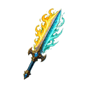 | `item_storm_blade` | 可跨项目复用的武器图标。 | 128×128 RGBA · single |
|  | `item_vampiric_blade` | 可跨项目复用的武器图标。 | 128×128 RGBA · single |
| 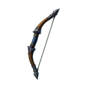 | `item_bow_basic` | 可跨项目复用的武器图标。 | 128×128 RGBA · single |
|  | `item_staff_arcane` | 可跨项目复用的武器图标。 | 128×128 RGBA · single |
|  | `item_master_staff` | 可跨项目复用的武器图标。 | 128×128 RGBA · single |
|  | `item_staff_basic` | 可跨项目复用的武器图标。 | 128×128 RGBA · single |
|  | `item_sword_basic` | 可跨项目复用的武器图标。 | 64×64 RGBA · single |
|  | `item_sword_fire` | 可跨项目复用的武器图标。 | 64×64 RGBA · single |
|  | `item_sword_steel` | 可跨项目复用的武器图标。 | 64×64 RGBA · single |

## 奥术技能图标

| 预览 | 资源 ID | 描述 | 规格 |
|---|---|---|---|
| 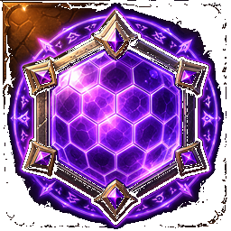 | `icon_arcane_barrier` | 可跨项目复用的奥术技能图标。 | 256×256 RGBA · single |
| 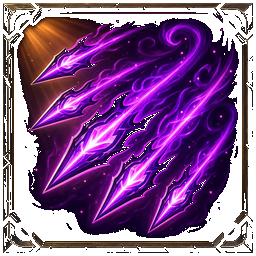 | `icon_arcane_missile` | 可跨项目复用的奥术技能图标。 | 256×256 RGBA · single |
|  | `icon_mana_mastery` | 可跨项目复用的奥术技能图标。 | 256×256 RGBA · single |
| 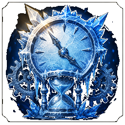 | `icon_time_freeze` | 可跨项目复用的奥术技能图标。 | 256×256 RGBA · single |

## 射击技能图标

| 预览 | 资源 ID | 描述 | 规格 |
|---|---|---|---|
| 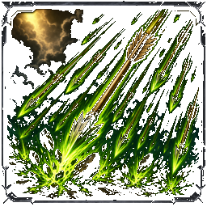 | `icon_arrow_storm` | 可跨项目复用的射击技能图标。 | 256×256 RGBA · single |
|  | `icon_eagle_eye` | 可跨项目复用的射击技能图标。 | 256×256 RGBA · single |
| 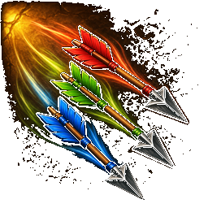 | `icon_multishot` | 可跨项目复用的射击技能图标。 | 256×256 RGBA · single |
| 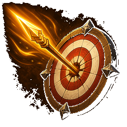 | `icon_piercing_arrow` | 可跨项目复用的射击技能图标。 | 256×256 RGBA · single |

## 防御技能图标

| 预览 | 资源 ID | 描述 | 规格 |
|---|---|---|---|
|  | `icon_iron_will` | 可跨项目复用的防御技能图标。 | 256×256 RGBA · single |
| 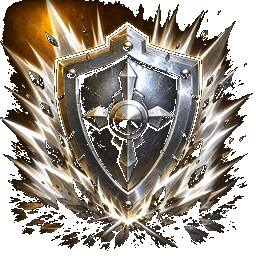 | `icon_shield_bash` | 可跨项目复用的防御技能图标。 | 256×256 RGBA · single |

## 元素技能图标

| 预览 | 资源 ID | 描述 | 规格 |
|---|---|---|---|
| 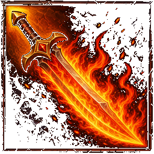 | `icon_fire_slash` | 可跨项目复用的元素技能图标。 | 256×256 RGBA · single |
| 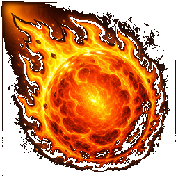 | `icon_flame_orb` | 可跨项目复用的元素技能图标。 | 256×256 RGBA · single |
| 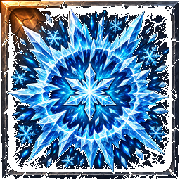 | `icon_frost_nova` | 可跨项目复用的元素技能图标。 | 256×256 RGBA · single |
| 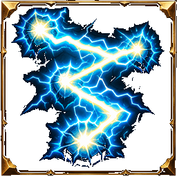 | `icon_lightning_chain` | 可跨项目复用的元素技能图标。 | 256×256 RGBA · single |
| 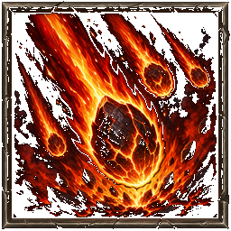 | `icon_meteor_storm` | 可跨项目复用的元素技能图标。 | 256×256 RGBA · single |
| 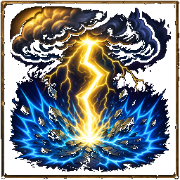 | `icon_thunder_clap` | 可跨项目复用的元素技能图标。 | 256×256 RGBA · single |

## 武技技能图标

| 预览 | 资源 ID | 描述 | 规格 |
|---|---|---|---|
| 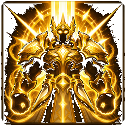 | `icon_avatar_wrath` | 可跨项目复用的武技技能图标。 | 256×256 RGBA · single |
| 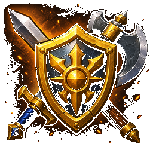 | `icon_battle_mastery` | 可跨项目复用的武技技能图标。 | 256×256 RGBA · single |
| 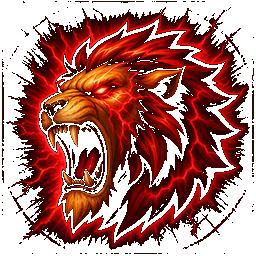 | `icon_berserk_shout` | 可跨项目复用的武技技能图标。 | 256×256 RGBA · single |
|  | `icon_cleave` | 可跨项目复用的武技技能图标。 | 256×256 RGBA · single |
| 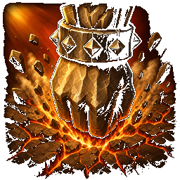 | `icon_ground_slam` | 可跨项目复用的武技技能图标。 | 256×256 RGBA · single |
| 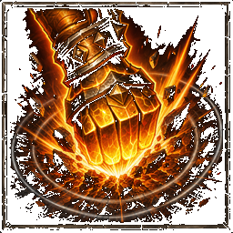 | `icon_power_strike` | 可跨项目复用的武技技能图标。 | 256×256 RGBA · single |
| 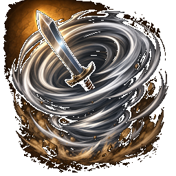 | `icon_whirlwind` | 可跨项目复用的武技技能图标。 | 256×256 RGBA · single |

## 奥术特效

| 预览 | 资源 ID | 描述 | 规格 |
|---|---|---|---|
|  | `vfx_time_freeze_single` | 可跨项目复用的奥术特效。 | 256×256 RGBA · single |

## 射击特效

| 预览 | 资源 ID | 描述 | 规格 |
|---|---|---|---|
| 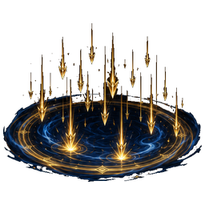 | `vfx_arrow_storm_single` | 可跨项目复用的射击特效。 | 256×256 RGBA · single |
| 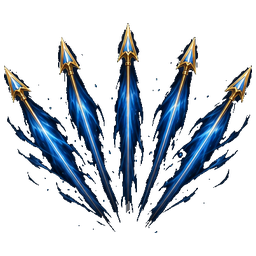 | `vfx_multishot_single` | 可跨项目复用的射击特效。 | 256×256 RGBA · single |
|  | `vfx_piercing_arrow_single` | 可跨项目复用的射击特效。 | 256×256 RGBA · single |

## 暗影刀光特效

| 预览 | 资源 ID | 描述 | 规格 |
|---|---|---|---|
| 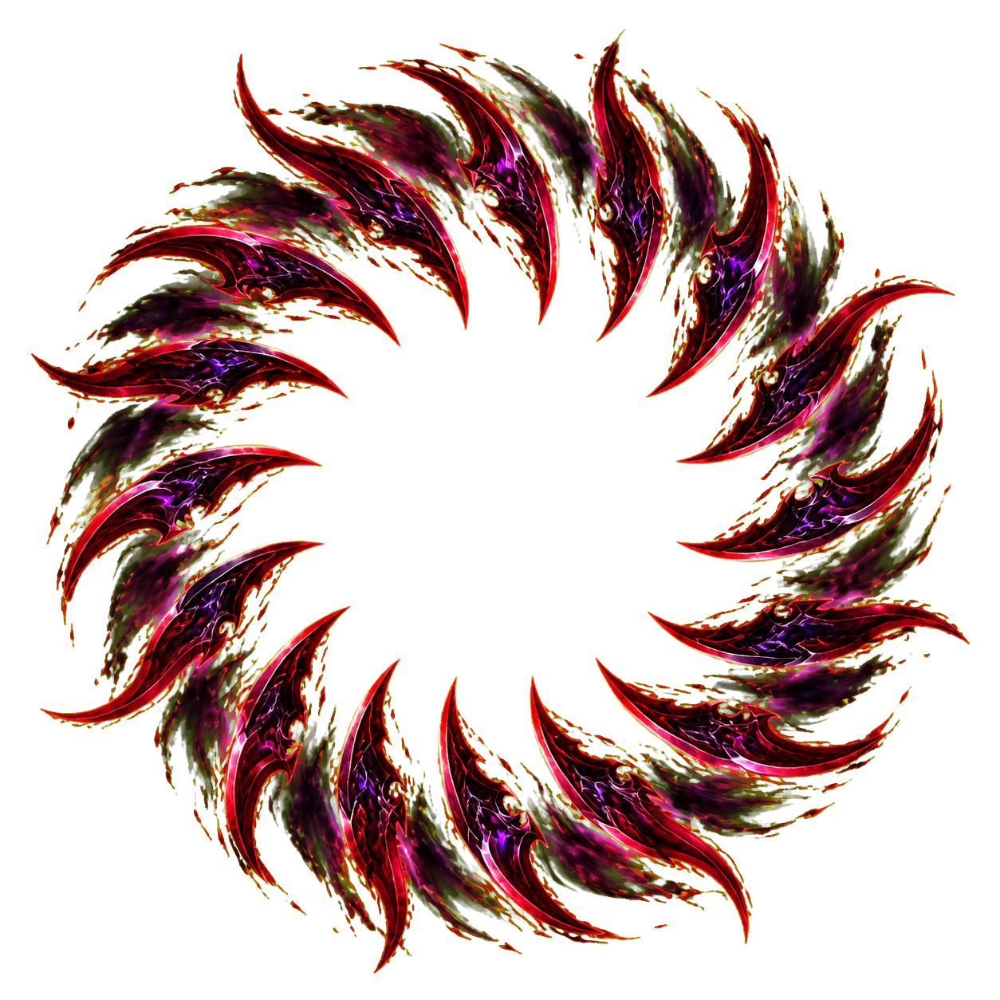 | `vfx_blood_blade_ring_single` | 可跨项目复用的暗影刀光特效。 | 1254×1254 RGBA · single |
| 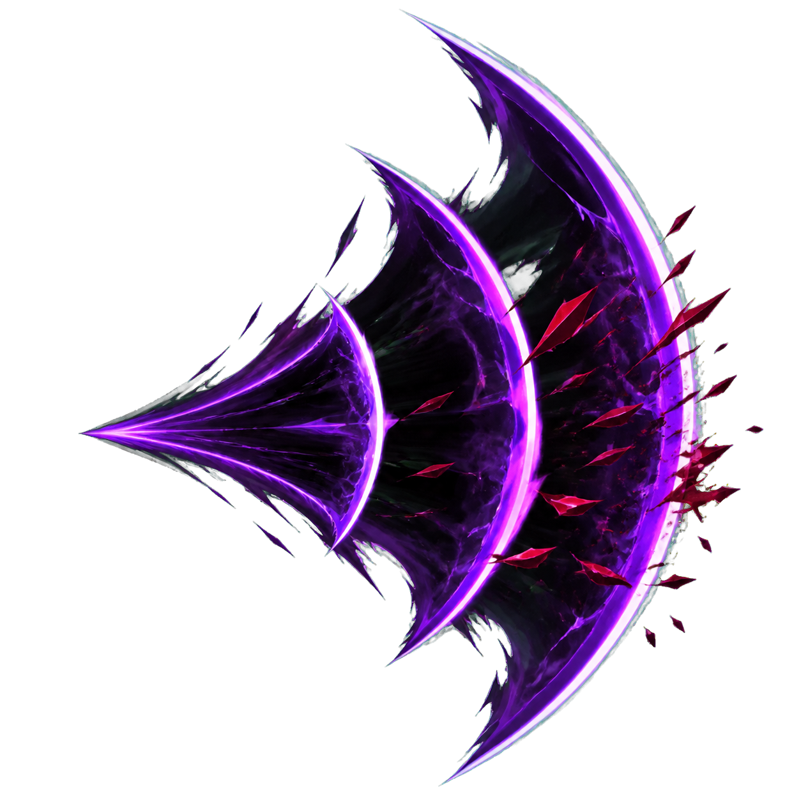 | `vfx_cleave_fan_single` | 可跨项目复用的暗影刀光特效。 | 1254×1254 RGBA · single |
|  | `vfx_poison_slash_single` | 可跨项目复用的暗影刀光特效。 | 1254×1254 RGBA · single |
| 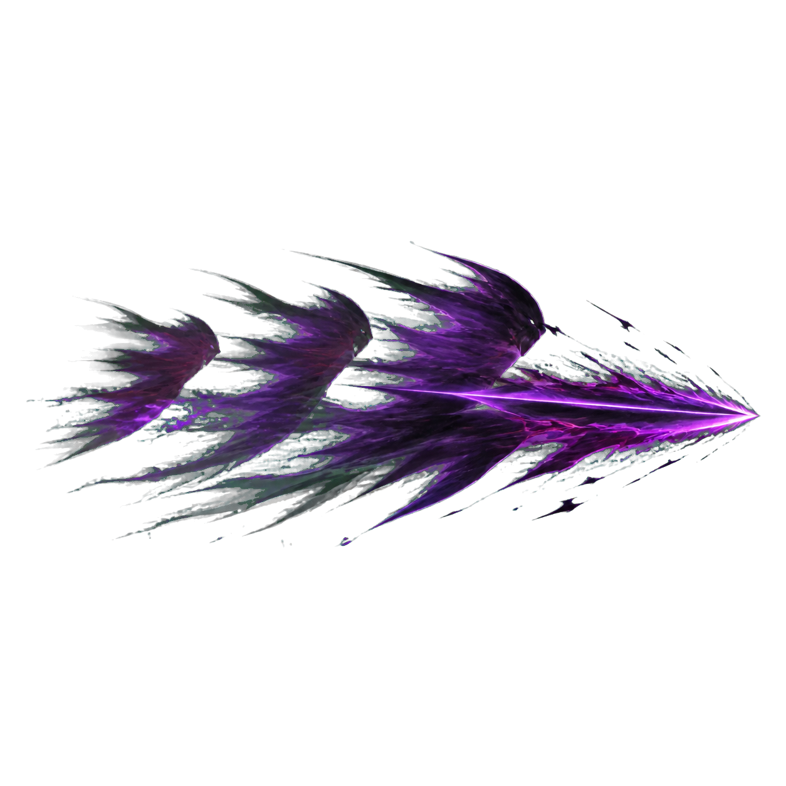 | `vfx_shadow_afterimage_single` | 可跨项目复用的暗影刀光特效。 | 1254×1254 RGBA · single |
|  | `vfx_shadow_arc_single` | 可跨项目复用的暗影刀光特效。 | 1254×1254 RGBA · single |
|  | `vfx_shadow_hit_single` | 可跨项目复用的暗影刀光特效。 | 1254×1254 RGBA · single |
|  | `vfx_void_blade_curtain_single` | 可跨项目复用的暗影刀光特效。 | 1254×1254 RGBA · single |

## 元素特效

| 预览 | 资源 ID | 描述 | 规格 |
|---|---|---|---|
|  | `vfx_fire_slash_single` | 可跨项目复用的元素特效。 | 256×256 RGBA · single |
| 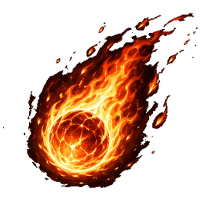 | `vfx_flame_orb_single` | 可跨项目复用的元素特效。 | 256×256 RGBA · single |
| 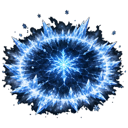 | `vfx_frost_nova_single` | 可跨项目复用的元素特效。 | 256×256 RGBA · single |
|  | `vfx_lightning_chain_single` | 可跨项目复用的元素特效。 | 256×256 RGBA · single |
| 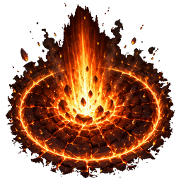 | `vfx_meteor_storm_single` | 可跨项目复用的元素特效。 | 256×256 RGBA · single |

## 命中特效

| 预览 | 资源 ID | 描述 | 规格 |
|---|---|---|---|
| 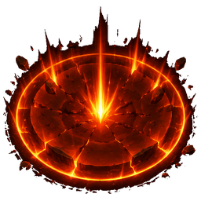 | `vfx_boss_slam_single` | 可跨项目复用的命中特效。 | 256×256 RGBA · single |
| 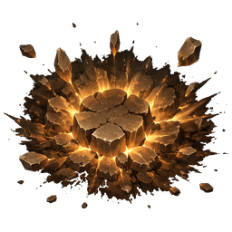 | `vfx_ground_impact_single` | 可跨项目复用的命中特效。 | 256×256 RGBA · single |
| 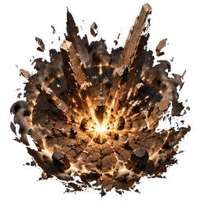 | `vfx_ground_slam_single` | 可跨项目复用的命中特效。 | 256×256 RGBA · single |
|  | `vfx_hit_spark_single` | 可跨项目复用的命中特效。 | 256×256 RGBA · single |
| 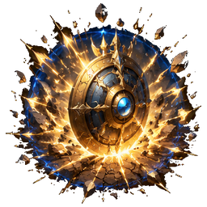 | `vfx_shield_bash_single` | 可跨项目复用的命中特效。 | 256×256 RGBA · single |

## 武技特效

| 预览 | 资源 ID | 描述 | 规格 |
|---|---|---|---|
|  | `vfx_avatar_wrath_single` | 可跨项目复用的武技特效。 | 256×256 RGBA · single |
|  | `vfx_berserk_shout_single` | 可跨项目复用的武技特效。 | 256×256 RGBA · single |
|  | `vfx_blink_cut_single` | 可跨项目复用的武技特效。 | 256×256 RGBA · single |
|  | `vfx_nightfall_execution_single` | 可跨项目复用的武技特效。 | 256×256 RGBA · single |
| 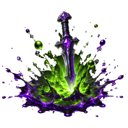 | `vfx_poison_blades_single` | 可跨项目复用的武技特效。 | 256×256 RGBA · single |
|  | `vfx_shadow_strike_single` | 可跨项目复用的武技特效。 | 256×256 RGBA · single |
|  | `vfx_whirlwind_single` | 可跨项目复用的武技特效。 | 256×256 RGBA · single |

## 弹道特效

| 预览 | 资源 ID | 描述 | 规格 |
|---|---|---|---|
|  | `vfx_arcane_missile_single` | 可跨项目复用的弹道特效。 | 256×256 RGBA · single |
|  | `vfx_archer_arrow_single` | 可跨项目复用的弹道特效。 | 256×256 RGBA · single |
| 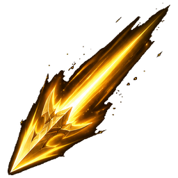 | `vfx_enemy_arrow_single` | 可跨项目复用的弹道特效。 | 256×256 RGBA · single |

## 四阶段特效

| 预览 | 资源 ID | 描述 | 规格 |
|---|---|---|---|
| 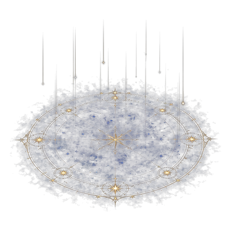 | `vfx_celestial_rain_4frame_v1` | 可跨项目复用的四阶段特效。 | 768×768 RGBA · 2x2 |
| 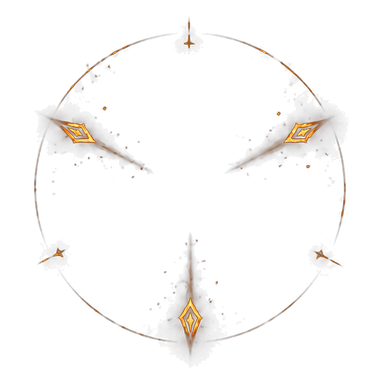 | `vfx_hunter_mark_4frame_v1` | 可跨项目复用的四阶段特效。 | 768×768 RGBA · 2x2 |
| 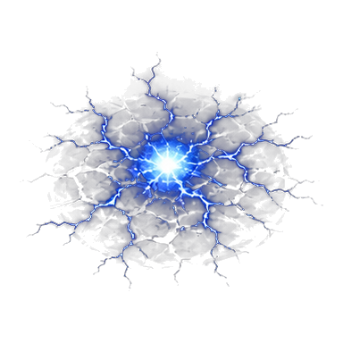 | `vfx_thunder_clap_4frame_v1` | 可跨项目复用的四阶段特效。 | 768×768 RGBA · 2x2 |
| 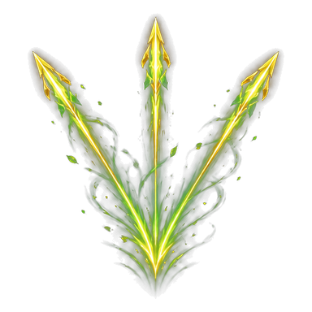 | `vfx_volley_burst_4frame_v1` | 可跨项目复用的四阶段特效。 | 768×768 RGBA · 2x2 |
| 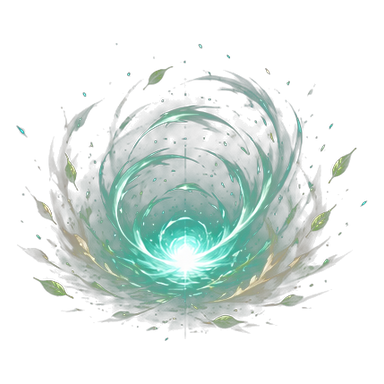 | `vfx_wind_step_4frame_v1` | 可跨项目复用的四阶段特效。 | 768×768 RGBA · 2x2 |
