# 水墨武侠图标与招式特效资源目录

> 本文档由 `python tools/build_art_resource_catalog.py` 从发布资源和规格自动生成，请勿手工改表格。

当前包含 **36 个图标**、**47 套四阶段特效**。

所有文件使用稳定的英文语义 ID，不包含具体游戏角色名、剧情名、绝对路径或 Godot `.import` 文件。

## 图标 · 线索与文书

| 预览 | 资源 ID | 内容描述 | 规格 | 文件 |
|---|---|---|---|---|
|  | `item_broken_mask` · 破损面具 | 表达“破损面具”物件语义的无字透明图标，适合背包、掉落、线索和任务界面。 | 256×256 RGBA；无字透明底 | [`icons/items/clues/item_broken_mask.png`](icons/items/clues/item_broken_mask.png) |
| 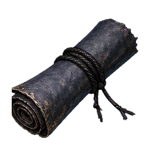 | `item_confession_scroll` · 供词卷轴 | 表达“供词卷轴”物件语义的无字透明图标，适合背包、掉落、线索和任务界面。 | 256×256 RGBA；无字透明底 | [`icons/items/clues/item_confession_scroll.png`](icons/items/clues/item_confession_scroll.png) |
|  | `item_evidence_statement` · 证物陈词 | 表达“证物陈词”物件语义的无字透明图标，适合背包、掉落、线索和任务界面。 | 256×256 RGBA；无字透明底 | [`icons/items/clues/item_evidence_statement.png`](icons/items/clues/item_evidence_statement.png) |
| 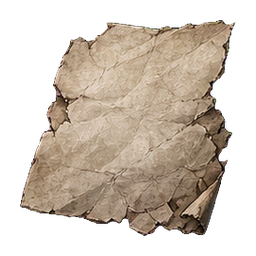 | `item_false_note` · 可疑字条 | 表达“可疑字条”物件语义的无字透明图标，适合背包、掉落、线索和任务界面。 | 256×256 RGBA；无字透明底 | [`icons/items/clues/item_false_note.png`](icons/items/clues/item_false_note.png) |
|  | `item_herbal_ledger` · 药材账册 | 表达“药材账册”物件语义的无字透明图标，适合背包、掉落、线索和任务界面。 | 256×256 RGBA；无字透明底 | [`icons/items/clues/item_herbal_ledger.png`](icons/items/clues/item_herbal_ledger.png) |
| 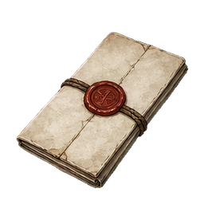 | `item_sealed_letter` · 封缄书信 | 表达“封缄书信”物件语义的无字透明图标，适合背包、掉落、线索和任务界面。 | 256×256 RGBA；无字透明底 | [`icons/items/clues/item_sealed_letter.png`](icons/items/clues/item_sealed_letter.png) |
|  | `item_testimony` · 证言文书 | 表达“证言文书”物件语义的无字透明图标，适合背包、掉落、线索和任务界面。 | 256×256 RGBA；无字透明底 | [`icons/items/clues/item_testimony.png`](icons/items/clues/item_testimony.png) |
| 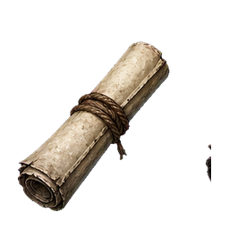 | `item_village_map` · 村落地图 | 表达“村落地图”物件语义的无字透明图标，适合背包、掉落、线索和任务界面。 | 256×256 RGBA；无字透明底 | [`icons/items/clues/item_village_map.png`](icons/items/clues/item_village_map.png) |

## 图标 · 材料

| 预览 | 资源 ID | 内容描述 | 规格 | 文件 |
|---|---|---|---|---|
| 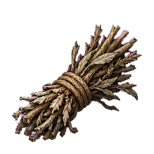 | `item_herb_bundle` · 药草束 | 表达“药草束”物件语义的无字透明图标，适合背包、掉落、线索和任务界面。 | 256×256 RGBA；无字透明底 | [`icons/items/materials/item_herb_bundle.png`](icons/items/materials/item_herb_bundle.png) |
| 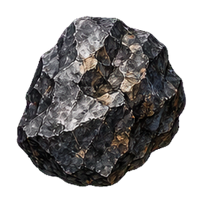 | `item_iron_ore` · 铁矿石 | 表达“铁矿石”物件语义的无字透明图标，适合背包、掉落、线索和任务界面。 | 256×256 RGBA；无字透明底 | [`icons/items/materials/item_iron_ore.png`](icons/items/materials/item_iron_ore.png) |
| 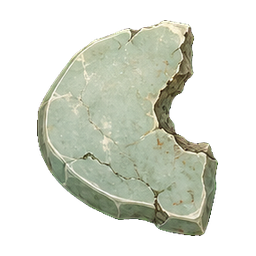 | `item_jade_fragment` · 玉石碎片 | 表达“玉石碎片”物件语义的无字透明图标，适合背包、掉落、线索和任务界面。 | 256×256 RGBA；无字透明底 | [`icons/items/materials/item_jade_fragment.png`](icons/items/materials/item_jade_fragment.png) |
|  | `item_luminous_silk` · 流光丝料 | 表达“流光丝料”物件语义的无字透明图标，适合背包、掉落、线索和任务界面。 | 256×256 RGBA；无字透明底 | [`icons/items/materials/item_luminous_silk.png`](icons/items/materials/item_luminous_silk.png) |
| 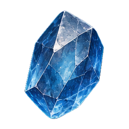 | `item_spirit_stone` · 灵性矿石 | 表达“灵性矿石”物件语义的无字透明图标，适合背包、掉落、线索和任务界面。 | 256×256 RGBA；无字透明底 | [`icons/items/materials/item_spirit_stone.png`](icons/items/materials/item_spirit_stone.png) |

## 图标 · 信物

| 预览 | 资源 ID | 内容描述 | 规格 | 文件 |
|---|---|---|---|---|
| 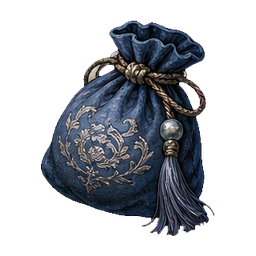 | `item_cold_incense_pouch` · 冷香囊 | 表达“冷香囊”物件语义的无字透明图标，适合背包、掉落、线索和任务界面。 | 256×256 RGBA；无字透明底 | [`icons/items/tokens/item_cold_incense_pouch.png`](icons/items/tokens/item_cold_incense_pouch.png) |
|  | `item_faction_token` · 门派令牌 | 表达“门派令牌”物件语义的无字透明图标，适合背包、掉落、线索和任务界面。 | 256×256 RGBA；无字透明底 | [`icons/items/tokens/item_faction_token.png`](icons/items/tokens/item_faction_token.png) |
| 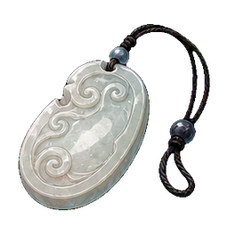 | `item_white_jade_pendant` · 白玉佩 | 表达“白玉佩”物件语义的无字透明图标，适合背包、掉落、线索和任务界面。 | 256×256 RGBA；无字透明底 | [`icons/items/tokens/item_white_jade_pendant.png`](icons/items/tokens/item_white_jade_pendant.png) |

## 图标 · 基础攻击

| 预览 | 资源 ID | 内容描述 | 规格 | 文件 |
|---|---|---|---|---|
|  | `icon_skill_basic_blade_v1` · 基础刀击 | 表达“基础刀击”语义的无字透明技能图标，适合技能列表、快捷栏和战斗 HUD。 | 256×256 RGBA；无字透明底 | [`icons/skills/basic/icon_skill_basic_blade_v1.png`](icons/skills/basic/icon_skill_basic_blade_v1.png) |
|  | `icon_skill_basic_staff_v1` · 基础棍击 | 表达“基础棍击”语义的无字透明技能图标，适合技能列表、快捷栏和战斗 HUD。 | 256×256 RGBA；无字透明底 | [`icons/skills/basic/icon_skill_basic_staff_v1.png`](icons/skills/basic/icon_skill_basic_staff_v1.png) |
|  | `icon_skill_basic_sword_v1` · 基础剑击 | 表达“基础剑击”语义的无字透明技能图标，适合技能列表、快捷栏和战斗 HUD。 | 256×256 RGBA；无字透明底 | [`icons/skills/basic/icon_skill_basic_sword_v1.png`](icons/skills/basic/icon_skill_basic_sword_v1.png) |
|  | `icon_skill_basic_unarmed_v1` · 基础拳击 | 表达“基础拳击”语义的无字透明技能图标，适合技能列表、快捷栏和战斗 HUD。 | 256×256 RGBA；无字透明底 | [`icons/skills/basic/icon_skill_basic_unarmed_v1.png`](icons/skills/basic/icon_skill_basic_unarmed_v1.png) |

## 图标 · 刀法

| 预览 | 资源 ID | 内容描述 | 规格 | 文件 |
|---|---|---|---|---|
|  | `icon_skill_blade_crescent_v1` · 弧月刀势 | 表达“弧月刀势”语义的无字透明技能图标，适合技能列表、快捷栏和战斗 HUD。 | 256×256 RGBA；无字透明底 | [`icons/skills/blade/icon_skill_blade_crescent_v1.png`](icons/skills/blade/icon_skill_blade_crescent_v1.png) |
|  | `icon_skill_blade_heavy_v1` · 重刀劈斩 | 表达“重刀劈斩”语义的无字透明技能图标，适合技能列表、快捷栏和战斗 HUD。 | 256×256 RGBA；无字透明底 | [`icons/skills/blade/icon_skill_blade_heavy_v1.png`](icons/skills/blade/icon_skill_blade_heavy_v1.png) |

## 图标 · 短刃

| 预览 | 资源 ID | 内容描述 | 规格 | 文件 |
|---|---|---|---|---|
| 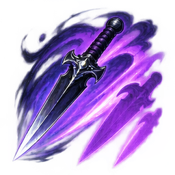 | `icon_skill_shadow_dagger_v1` · 暗影短刃 | 表达“暗影短刃”语义的无字透明技能图标，适合技能列表、快捷栏和战斗 HUD。 | 256×256 RGBA；无字透明底 | [`icons/skills/dagger/icon_skill_shadow_dagger_v1.png`](icons/skills/dagger/icon_skill_shadow_dagger_v1.png) |

## 图标 · 身法

| 预览 | 资源 ID | 内容描述 | 规格 | 文件 |
|---|---|---|---|---|
|  | `icon_skill_footwork_v1` · 轻功步法 | 表达“轻功步法”语义的无字透明技能图标，适合技能列表、快捷栏和战斗 HUD。 | 256×256 RGBA；无字透明底 | [`icons/skills/movement/icon_skill_footwork_v1.png`](icons/skills/movement/icon_skill_footwork_v1.png) |

## 图标 · 飞针

| 预览 | 资源 ID | 内容描述 | 规格 | 文件 |
|---|---|---|---|---|
| 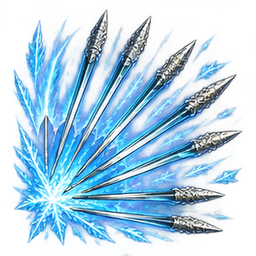 | `icon_skill_frost_needles_v1` · 寒霜针雨 | 表达“寒霜针雨”语义的无字透明技能图标，适合技能列表、快捷栏和战斗 HUD。 | 256×256 RGBA；无字透明底 | [`icons/skills/needle/icon_skill_frost_needles_v1.png`](icons/skills/needle/icon_skill_frost_needles_v1.png) |
|  | `icon_skill_poison_needles_v1` · 淬毒飞针 | 表达“淬毒飞针”语义的无字透明技能图标，适合技能列表、快捷栏和战斗 HUD。 | 256×256 RGBA；无字透明底 | [`icons/skills/needle/icon_skill_poison_needles_v1.png`](icons/skills/needle/icon_skill_poison_needles_v1.png) |

## 图标 · 掌法

| 预览 | 资源 ID | 内容描述 | 规格 | 文件 |
|---|---|---|---|---|
|  | `icon_skill_palm_wave_v1` · 掌劲气浪 | 表达“掌劲气浪”语义的无字透明技能图标，适合技能列表、快捷栏和战斗 HUD。 | 256×256 RGBA；无字透明底 | [`icons/skills/palm/icon_skill_palm_wave_v1.png`](icons/skills/palm/icon_skill_palm_wave_v1.png) |

## 图标 · 棍法

| 预览 | 资源 ID | 内容描述 | 规格 | 文件 |
|---|---|---|---|---|
|  | `icon_skill_staff_sweep_v1` · 长棍横扫 | 表达“长棍横扫”语义的无字透明技能图标，适合技能列表、快捷栏和战斗 HUD。 | 256×256 RGBA；无字透明底 | [`icons/skills/staff/icon_skill_staff_sweep_v1.png`](icons/skills/staff/icon_skill_staff_sweep_v1.png) |

## 图标 · 辅助与内功

| 预览 | 资源 ID | 内容描述 | 规格 | 文件 |
|---|---|---|---|---|
|  | `icon_skill_guard_v1` · 护体守御 | 表达“护体守御”语义的无字透明技能图标，适合技能列表、快捷栏和战斗 HUD。 | 256×256 RGBA；无字透明底 | [`icons/skills/support/icon_skill_guard_v1.png`](icons/skills/support/icon_skill_guard_v1.png) |
|  | `icon_skill_healing_v1` · 回生治疗 | 表达“回生治疗”语义的无字透明技能图标，适合技能列表、快捷栏和战斗 HUD。 | 256×256 RGBA；无字透明底 | [`icons/skills/support/icon_skill_healing_v1.png`](icons/skills/support/icon_skill_healing_v1.png) |
|  | `icon_skill_inner_breath_v1` · 吐纳内功 | 表达“吐纳内功”语义的无字透明技能图标，适合技能列表、快捷栏和战斗 HUD。 | 256×256 RGBA；无字透明底 | [`icons/skills/support/icon_skill_inner_breath_v1.png`](icons/skills/support/icon_skill_inner_breath_v1.png) |
|  | `icon_skill_redirect_v1` · 移劲卸力 | 表达“移劲卸力”语义的无字透明技能图标，适合技能列表、快捷栏和战斗 HUD。 | 256×256 RGBA；无字透明底 | [`icons/skills/support/icon_skill_redirect_v1.png`](icons/skills/support/icon_skill_redirect_v1.png) |

## 图标 · 剑法

| 预览 | 资源 ID | 内容描述 | 规格 | 文件 |
|---|---|---|---|---|
|  | `icon_skill_sword_cross_v1` · 交错剑光 | 表达“交错剑光”语义的无字透明技能图标，适合技能列表、快捷栏和战斗 HUD。 | 256×256 RGBA；无字透明底 | [`icons/skills/sword/icon_skill_sword_cross_v1.png`](icons/skills/sword/icon_skill_sword_cross_v1.png) |
| 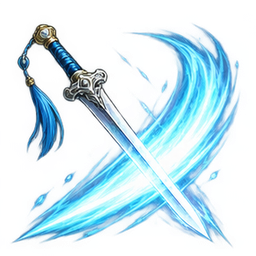 | `icon_skill_sword_slash_v1` · 剑气斩击 | 表达“剑气斩击”语义的无字透明技能图标，适合技能列表、快捷栏和战斗 HUD。 | 256×256 RGBA；无字透明底 | [`icons/skills/sword/icon_skill_sword_slash_v1.png`](icons/skills/sword/icon_skill_sword_slash_v1.png) |
|  | `icon_skill_sword_star_v1` · 星落剑芒 | 表达“星落剑芒”语义的无字透明技能图标，适合技能列表、快捷栏和战斗 HUD。 | 256×256 RGBA；无字透明底 | [`icons/skills/sword/icon_skill_sword_star_v1.png`](icons/skills/sword/icon_skill_sword_star_v1.png) |
|  | `icon_skill_sword_yinyang_v1` · 阴阳剑势 | 表达“阴阳剑势”语义的无字透明技能图标，适合技能列表、快捷栏和战斗 HUD。 | 256×256 RGBA；无字透明底 | [`icons/skills/sword/icon_skill_sword_yinyang_v1.png`](icons/skills/sword/icon_skill_sword_yinyang_v1.png) |

## 特效 · 刀法攻击

| 预览 | 资源 ID | 内容描述 | 规格 | 文件 |
|---|---|---|---|---|
| 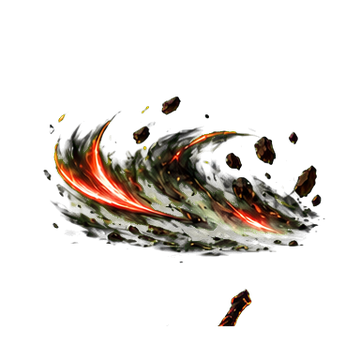 | `vfx_blade_black_wind_01` · 黑风刀卷 | “黑风刀卷”四阶段透明特效，按起势、增强、命中峰值、消散的顺序播放。 | 768×768 RGBA；2×2 / 4 帧；单帧 384×384 | [`vfx/attack/blade/vfx_blade_black_wind_01_4frame_v1.png`](vfx/attack/blade/vfx_blade_black_wind_01_4frame_v1.png) |
| 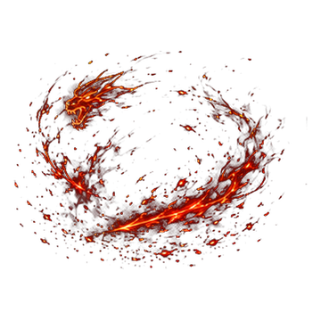 | `vfx_blade_earth_split_01` · 裂地刀势 | “裂地刀势”四阶段透明特效，按起势、增强、命中峰值、消散的顺序播放。 | 1024×1024 RGBA；2×2 / 4 帧；单帧 512×512 | [`vfx/attack/blade/vfx_blade_earth_split_01_4frame_v1.png`](vfx/attack/blade/vfx_blade_earth_split_01_4frame_v1.png) |
|  | `vfx_blade_gate_break_01` · 破门刀击 | “破门刀击”四阶段透明特效，按起势、增强、命中峰值、消散的顺序播放。 | 768×768 RGBA；2×2 / 4 帧；单帧 384×384 | [`vfx/attack/blade/vfx_blade_gate_break_01_4frame_v1.png`](vfx/attack/blade/vfx_blade_gate_break_01_4frame_v1.png) |
|  | `vfx_blade_heavy_cleave_01` · 厚重刀光 | “厚重刀光”四阶段透明特效，按起势、增强、命中峰值、消散的顺序播放。 | 1254×1254 RGBA；2×2 / 4 帧；单帧 627×627 | [`vfx/attack/blade/vfx_blade_heavy_cleave_01_4frame_v1.png`](vfx/attack/blade/vfx_blade_heavy_cleave_01_4frame_v1.png) |
| 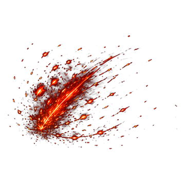 | `vfx_blade_tiger_impact_01` · 虎形刀势冲击 | “虎形刀势冲击”四阶段透明特效，按起势、增强、命中峰值、消散的顺序播放。 | 1024×1024 RGBA；2×2 / 4 帧；单帧 512×512 | [`vfx/attack/blade/vfx_blade_tiger_impact_01_4frame_v1.png`](vfx/attack/blade/vfx_blade_tiger_impact_01_4frame_v1.png) |
| 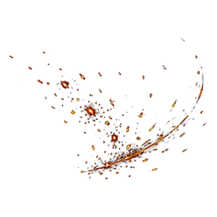 | `vfx_blade_vertical_cleave_01` · 纵向重刀劈斩 | “纵向重刀劈斩”四阶段透明特效，按起势、增强、命中峰值、消散的顺序播放。 | 1024×1024 RGBA；2×2 / 4 帧；单帧 512×512 | [`vfx/attack/blade/vfx_blade_vertical_cleave_01_4frame_v1.png`](vfx/attack/blade/vfx_blade_vertical_cleave_01_4frame_v1.png) |

## 特效 · 短刃攻击

| 预览 | 资源 ID | 内容描述 | 规格 | 文件 |
|---|---|---|---|---|
|  | `vfx_dagger_mist_combo_01` · 雾影连斩 | “雾影连斩”四阶段透明特效，按起势、增强、命中峰值、消散的顺序播放。 | 768×768 RGBA；2×2 / 4 帧；单帧 384×384 | [`vfx/attack/dagger/vfx_dagger_mist_combo_01_4frame_v1.png`](vfx/attack/dagger/vfx_dagger_mist_combo_01_4frame_v1.png) |
| 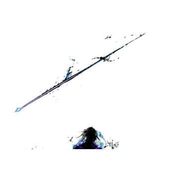 | `vfx_dagger_shadow_execution_01` · 暗影绝杀 | “暗影绝杀”四阶段透明特效，按起势、增强、命中峰值、消散的顺序播放。 | 768×768 RGBA；2×2 / 4 帧；单帧 384×384 | [`vfx/attack/dagger/vfx_dagger_shadow_execution_01_4frame_v1.png`](vfx/attack/dagger/vfx_dagger_shadow_execution_01_4frame_v1.png) |
|  | `vfx_dagger_wind_slash_01` · 短刃风切 | “短刃风切”四阶段透明特效，按起势、增强、命中峰值、消散的顺序播放。 | 768×768 RGBA；2×2 / 4 帧；单帧 384×384 | [`vfx/attack/dagger/vfx_dagger_wind_slash_01_4frame_v1.png`](vfx/attack/dagger/vfx_dagger_wind_slash_01_4frame_v1.png) |

## 特效 · 通用命中

| 预览 | 资源 ID | 内容描述 | 规格 | 文件 |
|---|---|---|---|---|
|  | `vfx_melee_basic_impact_01` · 基础近战命中 | “基础近战命中”四阶段透明特效，按起势、增强、命中峰值、消散的顺序播放。 | 1024×1024 RGBA；2×2 / 4 帧；单帧 512×512 | [`vfx/attack/misc/vfx_melee_basic_impact_01_4frame_v1.png`](vfx/attack/misc/vfx_melee_basic_impact_01_4frame_v1.png) |

## 特效 · 飞针攻击

| 预览 | 资源 ID | 内容描述 | 规格 | 文件 |
|---|---|---|---|---|
| 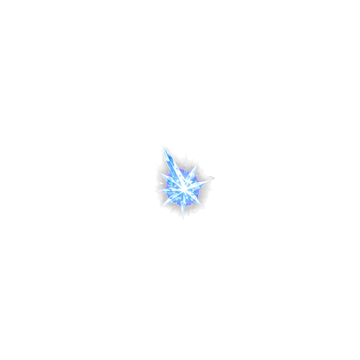 | `vfx_needle_frost_burst_01` · 寒针冰爆 | “寒针冰爆”四阶段透明特效，按起势、增强、命中峰值、消散的顺序播放。 | 1254×1254 RGBA；2×2 / 4 帧；单帧 627×627 | [`vfx/attack/needle/vfx_needle_frost_burst_01_4frame_v1.png`](vfx/attack/needle/vfx_needle_frost_burst_01_4frame_v1.png) |
| 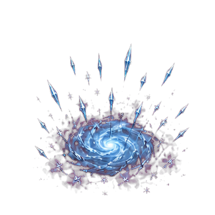 | `vfx_needle_frost_storm_01` · 寒霜针暴 | “寒霜针暴”四阶段透明特效，按起势、增强、命中峰值、消散的顺序播放。 | 768×768 RGBA；2×2 / 4 帧；单帧 384×384 | [`vfx/attack/needle/vfx_needle_frost_storm_01_4frame_v1.png`](vfx/attack/needle/vfx_needle_frost_storm_01_4frame_v1.png) |
| 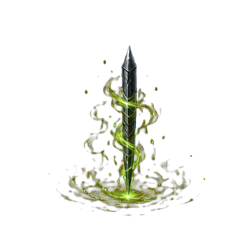 | `vfx_needle_poison_volley_01` · 毒针齐射 | “毒针齐射”四阶段透明特效，按起势、增强、命中峰值、消散的顺序播放。 | 768×768 RGBA；2×2 / 4 帧；单帧 384×384 | [`vfx/attack/needle/vfx_needle_poison_volley_01_4frame_v1.png`](vfx/attack/needle/vfx_needle_poison_volley_01_4frame_v1.png) |
| 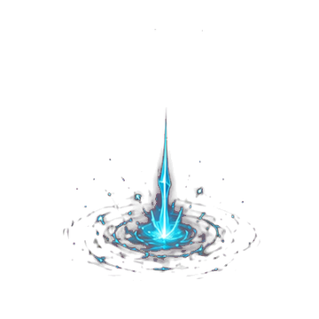 | `vfx_needle_silver_point_01` · 银针点刺 | “银针点刺”四阶段透明特效，按起势、增强、命中峰值、消散的顺序播放。 | 768×768 RGBA；2×2 / 4 帧；单帧 384×384 | [`vfx/attack/needle/vfx_needle_silver_point_01_4frame_v1.png`](vfx/attack/needle/vfx_needle_silver_point_01_4frame_v1.png) |

## 特效 · 掌法攻击

| 预览 | 资源 ID | 内容描述 | 规格 | 文件 |
|---|---|---|---|---|
|  | `vfx_palm_crimson_impact_01` · 赤色掌劲冲击 | “赤色掌劲冲击”四阶段透明特效，按起势、增强、命中峰值、消散的顺序播放。 | 1024×1024 RGBA；2×2 / 4 帧；单帧 512×512 | [`vfx/attack/palm/vfx_palm_crimson_impact_01_4frame_v1.png`](vfx/attack/palm/vfx_palm_crimson_impact_01_4frame_v1.png) |
| 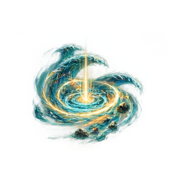 | `vfx_palm_ocean_shockwave_01` · 沧浪掌劲冲击 | “沧浪掌劲冲击”四阶段透明特效，按起势、增强、命中峰值、消散的顺序播放。 | 768×768 RGBA；2×2 / 4 帧；单帧 384×384 | [`vfx/attack/palm/vfx_palm_ocean_shockwave_01_4frame_v1.png`](vfx/attack/palm/vfx_palm_ocean_shockwave_01_4frame_v1.png) |

## 特效 · 棍法攻击

| 预览 | 资源 ID | 内容描述 | 规格 | 文件 |
|---|---|---|---|---|
|  | `vfx_staff_breaker_impact_01` · 破阵棍击 | “破阵棍击”四阶段透明特效，按起势、增强、命中峰值、消散的顺序播放。 | 1024×1024 RGBA；2×2 / 4 帧；单帧 512×512 | [`vfx/attack/staff/vfx_staff_breaker_impact_01_4frame_v1.png`](vfx/attack/staff/vfx_staff_breaker_impact_01_4frame_v1.png) |
|  | `vfx_staff_leaf_sweep_01` · 扫叶棍风 | “扫叶棍风”四阶段透明特效，按起势、增强、命中峰值、消散的顺序播放。 | 1024×1024 RGBA；2×2 / 4 帧；单帧 512×512 | [`vfx/attack/staff/vfx_staff_leaf_sweep_01_4frame_v1.png`](vfx/attack/staff/vfx_staff_leaf_sweep_01_4frame_v1.png) |
|  | `vfx_staff_wind_sweep_01` · 棍风横扫 | “棍风横扫”四阶段透明特效，按起势、增强、命中峰值、消散的顺序播放。 | 1024×1024 RGBA；2×2 / 4 帧；单帧 512×512 | [`vfx/attack/staff/vfx_staff_wind_sweep_01_4frame_v1.png`](vfx/attack/staff/vfx_staff_wind_sweep_01_4frame_v1.png) |

## 特效 · 剑法攻击

| 预览 | 资源 ID | 内容描述 | 规格 | 文件 |
|---|---|---|---|---|
|  | `vfx_sword_blue_arc_01` · 青蓝剑弧一 | “青蓝剑弧一”四阶段透明特效，按起势、增强、命中峰值、消散的顺序播放。 | 1254×1254 RGBA；2×2 / 4 帧；单帧 627×627 | [`vfx/attack/sword/vfx_sword_blue_arc_01_4frame_v1.png`](vfx/attack/sword/vfx_sword_blue_arc_01_4frame_v1.png) |
| 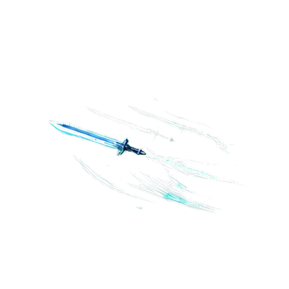 | `vfx_sword_blue_arc_02` · 青蓝剑弧二 | “青蓝剑弧二”四阶段透明特效，按起势、增强、命中峰值、消散的顺序播放。 | 768×768 RGBA；2×2 / 4 帧；单帧 384×384 | [`vfx/attack/sword/vfx_sword_blue_arc_02_4frame_v1.png`](vfx/attack/sword/vfx_sword_blue_arc_02_4frame_v1.png) |
| 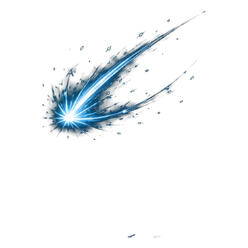 | `vfx_sword_cloud_pierce_01` · 破云穿刺剑光 | “破云穿刺剑光”四阶段透明特效，按起势、增强、命中峰值、消散的顺序播放。 | 1024×1024 RGBA；2×2 / 4 帧；单帧 512×512 | [`vfx/attack/sword/vfx_sword_cloud_pierce_01_4frame_v1.png`](vfx/attack/sword/vfx_sword_cloud_pierce_01_4frame_v1.png) |
| 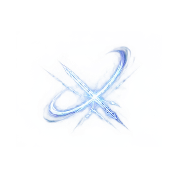 | `vfx_sword_counter_lines_01` · 破招剑线 | “破招剑线”四阶段透明特效，按起势、增强、命中峰值、消散的顺序播放。 | 768×768 RGBA；2×2 / 4 帧；单帧 384×384 | [`vfx/attack/sword/vfx_sword_counter_lines_01_4frame_v1.png`](vfx/attack/sword/vfx_sword_counter_lines_01_4frame_v1.png) |
| 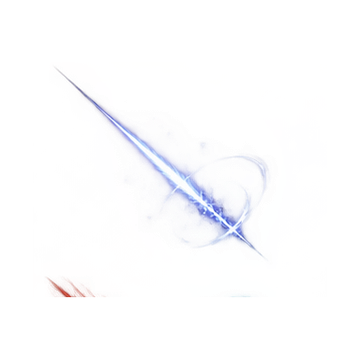 | `vfx_sword_falling_star_01` · 流星剑芒 | “流星剑芒”四阶段透明特效，按起势、增强、命中峰值、消散的顺序播放。 | 768×768 RGBA；2×2 / 4 帧；单帧 384×384 | [`vfx/attack/sword/vfx_sword_falling_star_01_4frame_v1.png`](vfx/attack/sword/vfx_sword_falling_star_01_4frame_v1.png) |
| 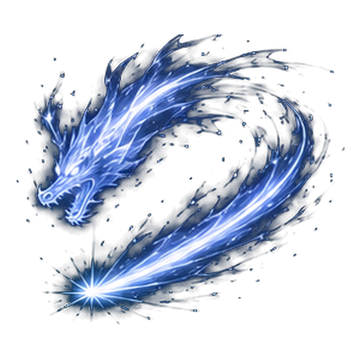 | `vfx_sword_mountain_arc_01` · 千山剑弧 | “千山剑弧”四阶段透明特效，按起势、增强、命中峰值、消散的顺序播放。 | 1024×1024 RGBA；2×2 / 4 帧；单帧 512×512 | [`vfx/attack/sword/vfx_sword_mountain_arc_01_4frame_v1.png`](vfx/attack/sword/vfx_sword_mountain_arc_01_4frame_v1.png) |
|  | `vfx_sword_straight_slash_01` · 直线剑斩 | “直线剑斩”四阶段透明特效，按起势、增强、命中峰值、消散的顺序播放。 | 1024×1024 RGBA；2×2 / 4 帧；单帧 512×512 | [`vfx/attack/sword/vfx_sword_straight_slash_01_4frame_v1.png`](vfx/attack/sword/vfx_sword_straight_slash_01_4frame_v1.png) |
|  | `vfx_sword_swallow_arc_01` · 燕返剑弧 | “燕返剑弧”四阶段透明特效，按起势、增强、命中峰值、消散的顺序播放。 | 1254×1254 RGBA；2×2 / 4 帧；单帧 627×627 | [`vfx/attack/sword/vfx_sword_swallow_arc_01_4frame_v1.png`](vfx/attack/sword/vfx_sword_swallow_arc_01_4frame_v1.png) |

## 特效 · 太极气劲

| 预览 | 资源 ID | 内容描述 | 规格 | 文件 |
|---|---|---|---|---|
|  | `vfx_taiji_dual_orbit_01` · 两仪环流 | “两仪环流”四阶段透明特效，按起势、增强、命中峰值、消散的顺序播放。 | 768×768 RGBA；2×2 / 4 帧；单帧 384×384 | [`vfx/attack/taiji/vfx_taiji_dual_orbit_01_4frame_v1.png`](vfx/attack/taiji/vfx_taiji_dual_orbit_01_4frame_v1.png) |
| 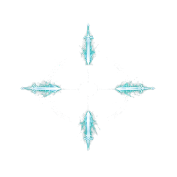 | `vfx_taiji_four_symbol_01` · 四象气旋 | “四象气旋”四阶段透明特效，按起势、增强、命中峰值、消散的顺序播放。 | 768×768 RGBA；2×2 / 4 帧；单帧 384×384 | [`vfx/attack/taiji/vfx_taiji_four_symbol_01_4frame_v1.png`](vfx/attack/taiji/vfx_taiji_four_symbol_01_4frame_v1.png) |
|  | `vfx_taiji_opening_01` · 太极起势 | “太极起势”四阶段透明特效，按起势、增强、命中峰值、消散的顺序播放。 | 1254×1254 RGBA；2×2 / 4 帧；单帧 627×627 | [`vfx/attack/taiji/vfx_taiji_opening_01_4frame_v1.png`](vfx/attack/taiji/vfx_taiji_opening_01_4frame_v1.png) |

## 特效 · 身法轨迹

| 预览 | 资源 ID | 内容描述 | 规格 | 文件 |
|---|---|---|---|---|
| 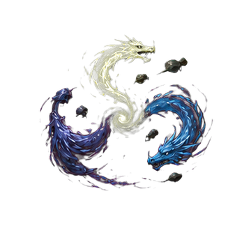 | `vfx_movement_dragon_turn_01` · 游龙折转轨迹 | “游龙折转轨迹”四阶段透明特效，按起势、增强、命中峰值、消散的顺序播放。 | 768×768 RGBA；2×2 / 4 帧；单帧 384×384 | [`vfx/movement/vfx_movement_dragon_turn_01_4frame_v1.png`](vfx/movement/vfx_movement_dragon_turn_01_4frame_v1.png) |
|  | `vfx_movement_moon_water_step_01` · 月下踏水步 | “月下踏水步”四阶段透明特效，按起势、增强、命中峰值、消散的顺序播放。 | 768×768 RGBA；2×2 / 4 帧；单帧 384×384 | [`vfx/movement/vfx_movement_moon_water_step_01_4frame_v1.png`](vfx/movement/vfx_movement_moon_water_step_01_4frame_v1.png) |
| 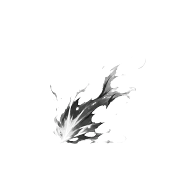 | `vfx_movement_shadow_step_01` · 暗影疾步 | “暗影疾步”四阶段透明特效，按起势、增强、命中峰值、消散的顺序播放。 | 1254×1254 RGBA；2×2 / 4 帧；单帧 627×627 | [`vfx/movement/vfx_movement_shadow_step_01_4frame_v1.png`](vfx/movement/vfx_movement_shadow_step_01_4frame_v1.png) |

## 特效 · 护体

| 预览 | 资源 ID | 内容描述 | 规格 | 文件 |
|---|---|---|---|---|
| 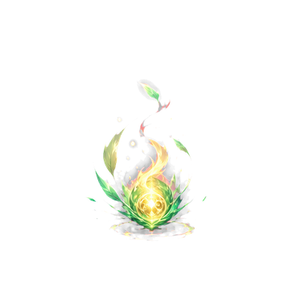 | `vfx_guard_blue_shield_01` · 青蓝护体屏障 | “青蓝护体屏障”四阶段透明特效，按起势、增强、命中峰值、消散的顺序播放。 | 1254×1254 RGBA；2×2 / 4 帧；单帧 627×627 | [`vfx/support/guard/vfx_guard_blue_shield_01_4frame_v1.png`](vfx/support/guard/vfx_guard_blue_shield_01_4frame_v1.png) |
|  | `vfx_guard_golden_bell_01` · 金钟护罩 | “金钟护罩”四阶段透明特效，按起势、增强、命中峰值、消散的顺序播放。 | 768×768 RGBA；2×2 / 4 帧；单帧 384×384 | [`vfx/support/guard/vfx_guard_golden_bell_01_4frame_v1.png`](vfx/support/guard/vfx_guard_golden_bell_01_4frame_v1.png) |
| 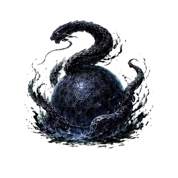 | `vfx_guard_tortoise_shell_01` · 玄甲护罩 | “玄甲护罩”四阶段透明特效，按起势、增强、命中峰值、消散的顺序播放。 | 768×768 RGBA；2×2 / 4 帧；单帧 384×384 | [`vfx/support/guard/vfx_guard_tortoise_shell_01_4frame_v1.png`](vfx/support/guard/vfx_guard_tortoise_shell_01_4frame_v1.png) |
| 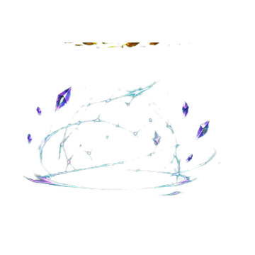 | `vfx_guard_violet_crystal_01` · 紫晶罡罩 | “紫晶罡罩”四阶段透明特效，按起势、增强、命中峰值、消散的顺序播放。 | 768×768 RGBA；2×2 / 4 帧；单帧 384×384 | [`vfx/support/guard/vfx_guard_violet_crystal_01_4frame_v1.png`](vfx/support/guard/vfx_guard_violet_crystal_01_4frame_v1.png) |
|  | `vfx_guard_wood_leaf_01` · 青木叶阵护罩 | “青木叶阵护罩”四阶段透明特效，按起势、增强、命中峰值、消散的顺序播放。 | 768×768 RGBA；2×2 / 4 帧；单帧 384×384 | [`vfx/support/guard/vfx_guard_wood_leaf_01_4frame_v1.png`](vfx/support/guard/vfx_guard_wood_leaf_01_4frame_v1.png) |

## 特效 · 治疗

| 预览 | 资源 ID | 内容描述 | 规格 | 文件 |
|---|---|---|---|---|
| 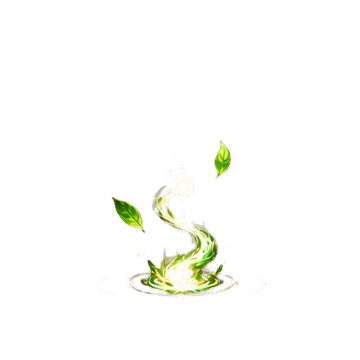 | `vfx_healing_emerald_breath_01` · 翠绿回生灵息 | “翠绿回生灵息”四阶段透明特效，按起势、增强、命中峰值、消散的顺序播放。 | 768×768 RGBA；2×2 / 4 帧；单帧 384×384 | [`vfx/support/healing/vfx_healing_emerald_breath_01_4frame_v1.png`](vfx/support/healing/vfx_healing_emerald_breath_01_4frame_v1.png) |

## 特效 · 内功

| 预览 | 资源 ID | 内容描述 | 规格 | 文件 |
|---|---|---|---|---|
|  | `vfx_inner_breath_green_01` · 青绿色吐纳气息 | “青绿色吐纳气息”四阶段透明特效，按起势、增强、命中峰值、消散的顺序播放。 | 768×768 RGBA；2×2 / 4 帧；单帧 384×384 | [`vfx/support/inner/vfx_inner_breath_green_01_4frame_v1.png`](vfx/support/inner/vfx_inner_breath_green_01_4frame_v1.png) |
| 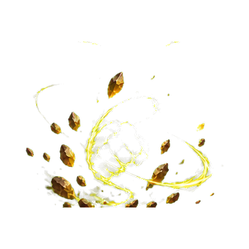 | `vfx_inner_gold_aura_01` · 金色内劲聚气 | “金色内劲聚气”四阶段透明特效，按起势、增强、命中峰值、消散的顺序播放。 | 768×768 RGBA；2×2 / 4 帧；单帧 384×384 | [`vfx/support/inner/vfx_inner_gold_aura_01_4frame_v1.png`](vfx/support/inner/vfx_inner_gold_aura_01_4frame_v1.png) |
| 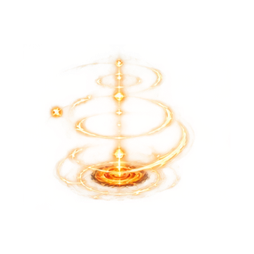 | `vfx_inner_meridian_gold_01` · 金色经脉淬炼 | “金色经脉淬炼”四阶段透明特效，按起势、增强、命中峰值、消散的顺序播放。 | 768×768 RGBA；2×2 / 4 帧；单帧 384×384 | [`vfx/support/inner/vfx_inner_meridian_gold_01_4frame_v1.png`](vfx/support/inner/vfx_inner_meridian_gold_01_4frame_v1.png) |
| 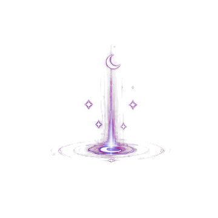 | `vfx_inner_moon_aura_01` · 月华内息 | “月华内息”四阶段透明特效，按起势、增强、命中峰值、消散的顺序播放。 | 768×768 RGBA；2×2 / 4 帧；单帧 384×384 | [`vfx/support/inner/vfx_inner_moon_aura_01_4frame_v1.png`](vfx/support/inner/vfx_inner_moon_aura_01_4frame_v1.png) |
| 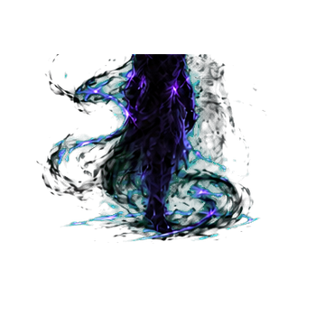 | `vfx_inner_shadow_aura_01` · 暗影内息 | “暗影内息”四阶段透明特效，按起势、增强、命中峰值、消散的顺序播放。 | 768×768 RGBA；2×2 / 4 帧；单帧 384×384 | [`vfx/support/inner/vfx_inner_shadow_aura_01_4frame_v1.png`](vfx/support/inner/vfx_inner_shadow_aura_01_4frame_v1.png) |
| 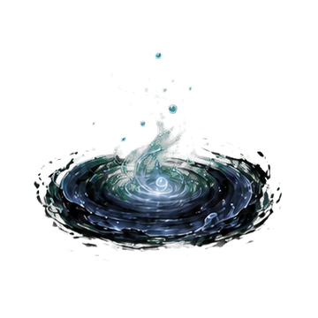 | `vfx_inner_taiji_aura_01` · 太极内息 | “太极内息”四阶段透明特效，按起势、增强、命中峰值、消散的顺序播放。 | 768×768 RGBA；2×2 / 4 帧；单帧 384×384 | [`vfx/support/inner/vfx_inner_taiji_aura_01_4frame_v1.png`](vfx/support/inner/vfx_inner_taiji_aura_01_4frame_v1.png) |
|  | `vfx_inner_violet_cloud_01` · 紫云内息 | “紫云内息”四阶段透明特效，按起势、增强、命中峰值、消散的顺序播放。 | 768×768 RGBA；2×2 / 4 帧；单帧 384×384 | [`vfx/support/inner/vfx_inner_violet_cloud_01_4frame_v1.png`](vfx/support/inner/vfx_inner_violet_cloud_01_4frame_v1.png) |

## 特效 · 卸力与转化

| 预览 | 资源 ID | 内容描述 | 规格 | 文件 |
|---|---|---|---|---|
| 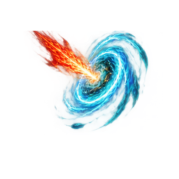 | `vfx_redirect_water_swirl_01` · 回澜卸力水旋 | “回澜卸力水旋”四阶段透明特效，按起势、增强、命中峰值、消散的顺序播放。 | 768×768 RGBA；2×2 / 4 帧；单帧 384×384 | [`vfx/support/redirect/vfx_redirect_water_swirl_01_4frame_v1.png`](vfx/support/redirect/vfx_redirect_water_swirl_01_4frame_v1.png) |
