# 跨平台 RPG UI Kit v1资源目录

> 本文档由 `python tools/build_resource_pack.py` 自动生成，请勿手工修改。

当前包含 **62 个资源条目**。

## 核心控件

| 预览 | 资源 ID | 描述 | 规格 |
|---|---|---|---|
| 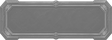 | `ui_button_compact_disabled` | 无文字、可跨项目适配的 RPG UI 组件。 | 112×40 RGBA · single |
| 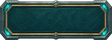 | `ui_button_compact_hover` | 无文字、可跨项目适配的 RPG UI 组件。 | 112×40 RGBA · single |
| 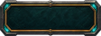 | `ui_button_compact_normal` | 无文字、可跨项目适配的 RPG UI 组件。 | 112×40 RGBA · single |
| 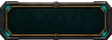 | `ui_button_compact_pressed` | 无文字、可跨项目适配的 RPG UI 组件。 | 112×40 RGBA · single |
| 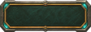 | `ui_button_compact_selected` | 无文字、可跨项目适配的 RPG UI 组件。 | 112×40 RGBA · single |
| 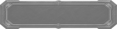 | `ui_button_primary_disabled` | 无文字、可跨项目适配的 RPG UI 组件。 | 192×48 RGBA · single |
| 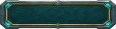 | `ui_button_primary_hover` | 无文字、可跨项目适配的 RPG UI 组件。 | 192×48 RGBA · single |
| 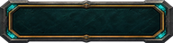 | `ui_button_primary_normal` | 无文字、可跨项目适配的 RPG UI 组件。 | 192×48 RGBA · single |
| 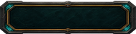 | `ui_button_primary_pressed` | 无文字、可跨项目适配的 RPG UI 组件。 | 192×48 RGBA · single |
| 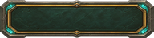 | `ui_button_primary_selected` | 无文字、可跨项目适配的 RPG UI 组件。 | 192×48 RGBA · single |
| 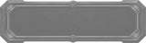 | `ui_button_secondary_disabled` | 无文字、可跨项目适配的 RPG UI 组件。 | 160×48 RGBA · single |
| 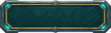 | `ui_button_secondary_hover` | 无文字、可跨项目适配的 RPG UI 组件。 | 160×48 RGBA · single |
| 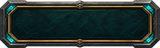 | `ui_button_secondary_normal` | 无文字、可跨项目适配的 RPG UI 组件。 | 160×48 RGBA · single |
| 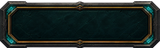 | `ui_button_secondary_pressed` | 无文字、可跨项目适配的 RPG UI 组件。 | 160×48 RGBA · single |
| 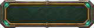 | `ui_button_secondary_selected` | 无文字、可跨项目适配的 RPG UI 组件。 | 160×48 RGBA · single |
| 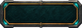 | `ui_button_small` | 无文字、可跨项目适配的 RPG UI 组件。 | 82×28 RGBA · single |
|  | `ui_checkbox_disabled` | 无文字、可跨项目适配的 RPG UI 组件。 | 18×18 RGBA · single |
|  | `ui_checkbox_hover` | 无文字、可跨项目适配的 RPG UI 组件。 | 18×18 RGBA · single |
|  | `ui_checkbox_off` | 无文字、可跨项目适配的 RPG UI 组件。 | 18×18 RGBA · single |
|  | `ui_checkbox_on` | 无文字、可跨项目适配的 RPG UI 组件。 | 18×18 RGBA · single |
|  | `ui_close_button` | 无文字、可跨项目适配的 RPG UI 组件。 | 30×30 RGBA · single |
|  | `ui_dialogue_choice` | 无文字、可跨项目适配的 RPG UI 组件。 | 320×42 RGBA · single |

## 核心进度条

| 预览 | 资源 ID | 描述 | 规格 |
|---|---|---|---|
|  | `ui_meter_fill_health` | 无文字、可跨项目适配的 RPG UI 组件。 | 260×12 RGBA · single |
|  | `ui_meter_fill_mana` | 无文字、可跨项目适配的 RPG UI 组件。 | 260×12 RGBA · single |
|  | `ui_meter_fill_xp` | 无文字、可跨项目适配的 RPG UI 组件。 | 260×12 RGBA · single |
|  | `ui_meter_frame` | 无文字、可跨项目适配的 RPG UI 组件。 | 260×12 RGBA · single |

## 核心面板

| 预览 | 资源 ID | 描述 | 规格 |
|---|---|---|---|
|  | `ui_dialog_frame` | 无文字、可跨项目适配的 RPG UI 组件。 | 320×64 RGBA · single |
| 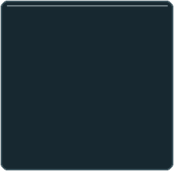 | `ui_hero_card_frame` | 无文字、可跨项目适配的 RPG UI 组件。 | 250×246 RGBA · single |
| 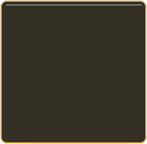 | `ui_hero_card_selected` | 无文字、可跨项目适配的 RPG UI 组件。 | 250×246 RGBA · single |
|  | `ui_list_row` | 无文字、可跨项目适配的 RPG UI 组件。 | 320×42 RGBA · single |
| 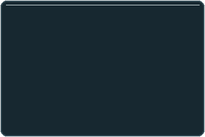 | `ui_map_card_frame` | 无文字、可跨项目适配的 RPG UI 组件。 | 344×230 RGBA · single |
| 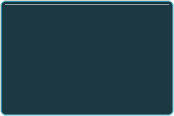 | `ui_map_card_selected` | 无文字、可跨项目适配的 RPG UI 组件。 | 344×230 RGBA · single |
|  | `ui_panel_frame` | 无文字、可跨项目适配的 RPG UI 组件。 | 96×96 RGBA · single |
|  | `ui_panel_header` | 无文字、可跨项目适配的 RPG UI 组件。 | 96×32 RGBA · single |
|  | `ui_panel_inset` | 无文字、可跨项目适配的 RPG UI 组件。 | 72×72 RGBA · single |
|  | `ui_quest_tracker` | 无文字、可跨项目适配的 RPG UI 组件。 | 320×112 RGBA · single |
|  | `ui_reward_row` | 无文字、可跨项目适配的 RPG UI 组件。 | 320×50 RGBA · single |
|  | `ui_title_bar` | 无文字、可跨项目适配的 RPG UI 组件。 | 320×40 RGBA · single |

## 核心槽位

| 预览 | 资源 ID | 描述 | 规格 |
|---|---|---|---|
|  | `ui_hotkey_frame` | 无文字、可跨项目适配的 RPG UI 组件。 | 62×62 RGBA · single |
| 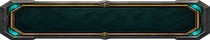 | `ui_select_frame` | 无文字、可跨项目适配的 RPG UI 组件。 | 210×40 RGBA · single |
|  | `ui_skill_slot` | 无文字、可跨项目适配的 RPG UI 组件。 | 46×46 RGBA · single |
|  | `ui_skill_slot_selected` | 无文字、可跨项目适配的 RPG UI 组件。 | 46×46 RGBA · single |

## HUD 状态组件

| 预览 | 资源 ID | 描述 | 规格 |
|---|---|---|---|
|  | `ui_hud_base_status_frame` | 无文字、可跨项目适配的 RPG UI 组件。 | 196×42 RGBA · single |
|  | `ui_hud_base_status_frame_transparent` | 无文字、可跨项目适配的 RPG UI 组件。 | 196×42 RGBA · single |
|  | `ui_hud_crystal_status_panel` | 无文字、可跨项目适配的 RPG UI 组件。 | 218×54 RGBA · single |
| 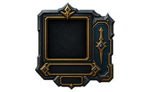 | `ui_hud_hero_status_panel` | 无文字、可跨项目适配的 RPG UI 组件。 | 248×152 RGBA · single |
| 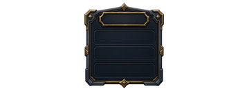 | `ui_hud_objective_panel` | 无文字、可跨项目适配的 RPG UI 组件。 | 360×132 RGBA · single |
|  | `ui_hud_party_row_frame` | 无文字、可跨项目适配的 RPG UI 组件。 | 196×44 RGBA · single |
|  | `ui_hud_resource_bar_frame` | 无文字、可跨项目适配的 RPG UI 组件。 | 210×20 RGBA · single |
|  | `ui_hud_resource_bar_frame_fixed` | 无文字、可跨项目适配的 RPG UI 组件。 | 210×20 RGBA · single |

## 移动端控件

| 预览 | 资源 ID | 描述 | 规格 |
|---|---|---|---|
|  | `ui_mobile_attack_button` | 无文字、可跨项目适配的 RPG UI 组件。 | 160×160 RGBA · single |
| 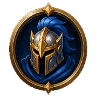 | `ui_mobile_character_button` | 无文字、可跨项目适配的 RPG UI 组件。 | 160×160 RGBA · single |
| 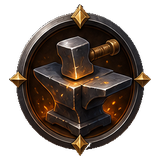 | `ui_mobile_crafting_button` | 无文字、可跨项目适配的 RPG UI 组件。 | 160×160 RGBA · single |
| 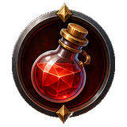 | `ui_mobile_hp_potion_button` | 无文字、可跨项目适配的 RPG UI 组件。 | 160×160 RGBA · single |
|  | `ui_mobile_interact_button` | 无文字、可跨项目适配的 RPG UI 组件。 | 160×160 RGBA · single |
|  | `ui_mobile_inventory_button` | 无文字、可跨项目适配的 RPG UI 组件。 | 160×160 RGBA · single |
|  | `ui_mobile_joystick_base` | 无文字、可跨项目适配的 RPG UI 组件。 | 160×160 RGBA · single |
|  | `ui_mobile_joystick_knob` | 无文字、可跨项目适配的 RPG UI 组件。 | 160×160 RGBA · single |
| 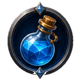 | `ui_mobile_mp_potion_button` | 无文字、可跨项目适配的 RPG UI 组件。 | 160×160 RGBA · single |
|  | `ui_mobile_shop_button` | 无文字、可跨项目适配的 RPG UI 组件。 | 160×160 RGBA · single |
|  | `ui_mobile_skill_button` | 无文字、可跨项目适配的 RPG UI 组件。 | 160×160 RGBA · single |
|  | `ui_mobile_skills_button` | 无文字、可跨项目适配的 RPG UI 组件。 | 160×160 RGBA · single |
